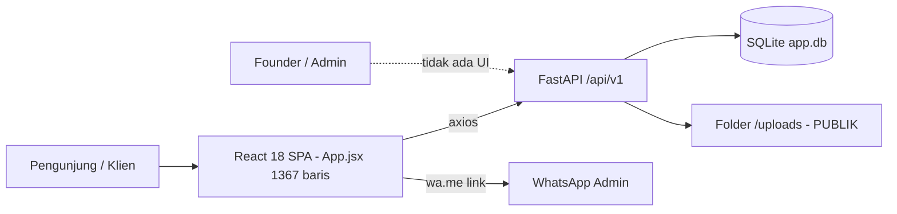
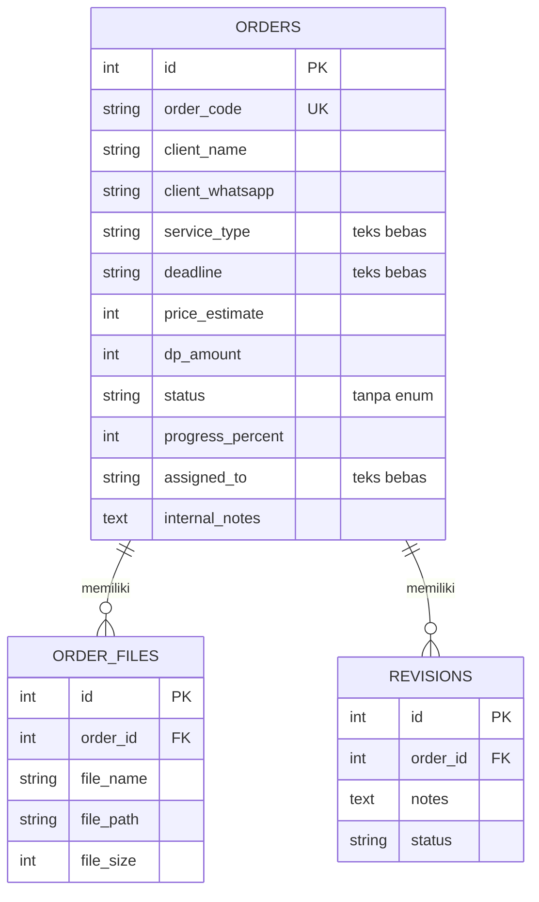
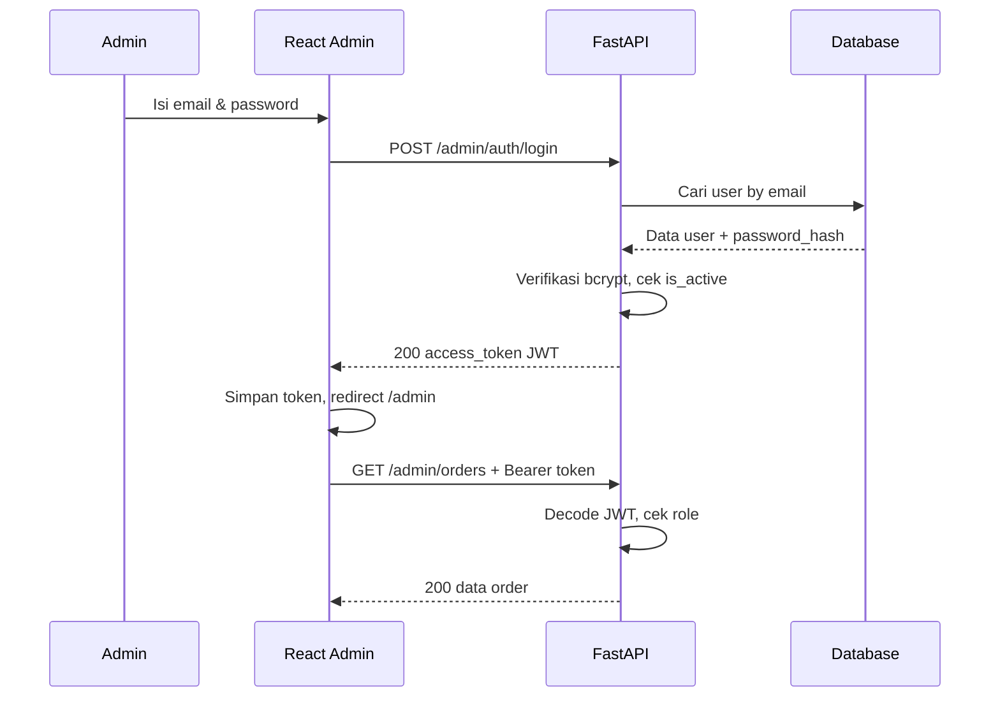
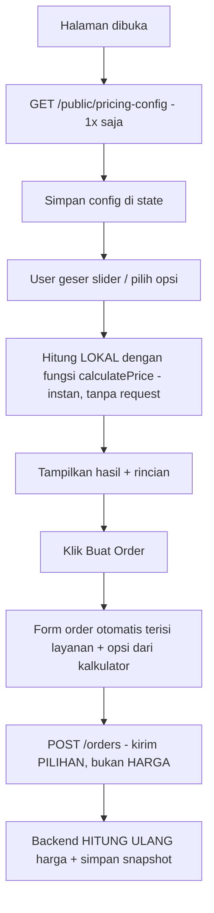
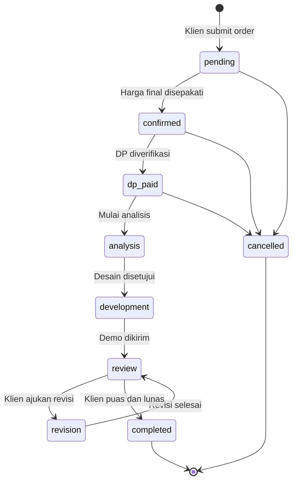
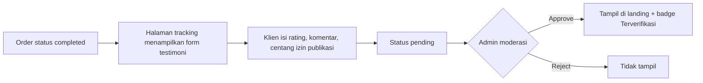
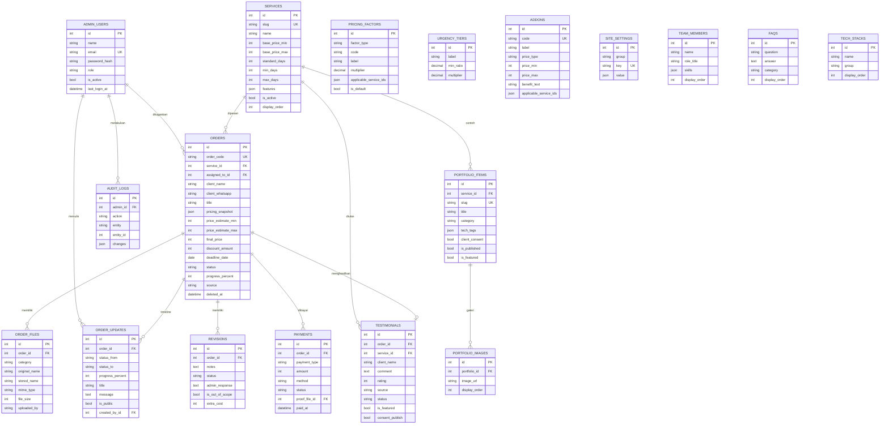
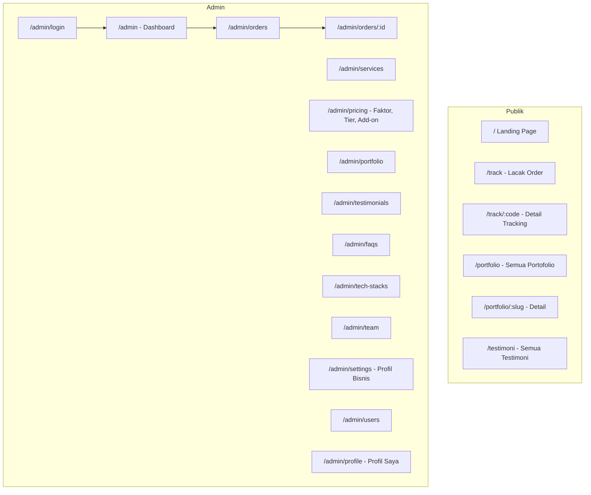
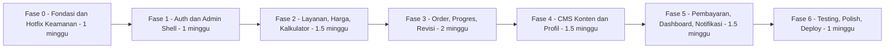

# 📘 PRD — Rizofara Technology Platform v2.0
### Product Requirements Document: Admin Panel, CMS (CRUD), Kalkulator Dinamis, Order & Progress Management

| Item | Keterangan |
| :--- | :--- |
| **Versi Dokumen** | 1.0 |
| **Tanggal** | 19 Oktober 2026 |
| **Status** | Draft — menunggu review Founder |
| **Basis Analisis** | Commit `e0d9276` (second commit - change name & logo) |
| **Pemilik Produk** | Founder 1 (Lead Tech & AI) & Founder 2 (Frontend & Client Ops) |

> 💡 **Apa itu PRD?**
> *Product Requirements Document* adalah dokumen yang menjelaskan **APA** yang harus dibangun dan **KENAPA**, sebelum masuk ke **BAGAIMANA** (coding). PRD jadi "kontrak" antara pemilik bisnis dan developer agar semua orang punya gambaran yang sama. Kalau ada perdebatan "fitur ini perlu atau tidak?", jawabannya dicari di PRD.

---

## 📑 Daftar Isi

1. [Ringkasan Eksekutif](#1-ringkasan-eksekutif)
2. [Analisis Kondisi Saat Ini (As-Is)](#2-analisis-kondisi-saat-ini-as-is)
3. [Temuan Masalah: Bug, Keamanan & Technical Debt](#3-temuan-masalah-bug-keamanan--technical-debt)
4. [Gap Analysis: Apa yang Harus Ditambahkan](#4-gap-analysis-apa-yang-harus-ditambahkan)
5. [Tujuan, Persona & Peran Pengguna](#5-tujuan-persona--peran-pengguna)
6. [Ruang Lingkup & Prioritas (MoSCoW)](#6-ruang-lingkup--prioritas-moscow)
7. [Spesifikasi Fitur per Modul](#7-spesifikasi-fitur-per-modul)
8. [Desain Data Model (Database)](#8-desain-data-model-database)
9. [Spesifikasi API](#9-spesifikasi-api)
10. [Struktur Frontend & Halaman](#10-struktur-frontend--halaman)
11. [Kebutuhan Non-Fungsional](#11-kebutuhan-non-fungsional)
12. [Arsitektur Target & Struktur Folder](#12-arsitektur-target--struktur-folder)
13. [Roadmap Pengerjaan Bertahap](#13-roadmap-pengerjaan-bertahap)
14. [Rencana Pengujian](#14-rencana-pengujian)
15. [Risiko & Mitigasi](#15-risiko--mitigasi)
16. [Pertanyaan Terbuka](#16-pertanyaan-terbuka)
17. [Glosarium (Kamus Istilah)](#17-glosarium-kamus-istilah)

---

## 1. Ringkasan Eksekutif

**Rizofara Technology** adalah website bisnis jasa asistensi akademik (skripsi, tugas kuliah) dan software house (website, chatbot AI). Versi saat ini (v1) sudah memiliki **landing page yang menarik**, **kalkulator estimasi biaya**, **form order + upload file**, dan **pelacak status order**.

Namun, v1 masih berupa **"website statis dengan sedikit backend"**:

- ❌ **Tidak ada panel admin & login** → Founder tidak bisa mengelola order kecuali lewat Swagger `/docs`.
- ❌ **Semua konten hardcoded** di `App.jsx` → Mengubah harga, portofolio, atau testimoni harus edit kode lalu build ulang.
- ❌ **Ada celah keamanan serius** → Data klien (nama, judul skripsi, file) bisa diakses siapa saja.
- ❌ **Tidak ada pencatatan pembayaran & riwayat progres** → Sulit memantau keuangan & komunikasi ke klien.

**Tujuan v2.0:** mengubah website menjadi **platform operasional bisnis** lengkap dengan Admin Panel, CMS (CRUD konten), kalkulator harga yang bisa diatur dari admin, manajemen order beserta progres, pembayaran, testimoni, dan portofolio.

---

## 2. Analisis Kondisi Saat Ini (As-Is)

### 2.1 Arsitektur Teknologi



| Layer | Teknologi | File Utama |
| :--- | :--- | :--- |
| Backend | FastAPI, SQLAlchemy 2, Pydantic v2, Uvicorn | [main.py](file:///e:/DATA/Ngoding/sofia/WebsiteFreelance/backend/app/main.py) |
| Database | SQLite (tabel dibuat via `create_all`, tanpa migrasi) | [session.py](file:///e:/DATA/Ngoding/sofia/WebsiteFreelance/backend/app/db/session.py) |
| Frontend | React 18, Vite 5, Tailwind 3, Axios, Lucide Icons | [App.jsx](file:///e:/DATA/Ngoding/sofia/WebsiteFreelance/frontend/src/App.jsx) |
| Deploy | FastAPI menyajikan hasil build React (`frontend/dist`) | [main.py#L38-L57](file:///e:/DATA/Ngoding/sofia/WebsiteFreelance/backend/app/main.py#L38-L57) |

> 💡 **Penjelasan:** Pola "FastAPI menyajikan file React hasil build" artinya cukup 1 server untuk frontend + backend. Ini praktis untuk project kecil. Kekurangannya: setiap ubah frontend harus `npm run build` ulang.

### 2.2 Inventaris Fitur yang Sudah Ada

| # | Fitur | Status | Catatan |
| :--- | :--- | :--- | :--- |
| 1 | Landing page (Hero, Trust badge, Tech stack) | ✅ Ada | Teks hardcoded |
| 2 | Katalog 4 layanan | ✅ Ada | Hardcoded, tidak bisa CRUD |
| 3 | Kalkulator estimasi biaya | ✅ Ada | Harga & multiplier hardcoded di Python |
| 4 | Form order + upload 1 file | ✅ Ada | Tanpa validasi file |
| 5 | Lacak order (kode / no. WA) | ⚠️ Ada, **bocor data** | Lihat temuan S-02 |
| 6 | Pengajuan revisi oleh klien | ✅ Ada | Admin tidak bisa merespons revisi |
| 7 | Portofolio (3 item) | ⚠️ Statis | Hardcoded |
| 8 | Testimoni (4 item) | ⚠️ Statis | Hardcoded, kirim via WA manual |
| 9 | FAQ (4 item) | ⚠️ Statis | Hardcoded |
| 10 | Generator link WhatsApp | ✅ Ada | Endpoint ada, tapi FE tidak memakainya |
| 11 | Update status order | ⚠️ Hanya via API | **Tanpa autentikasi** |
| 12 | Login admin / dashboard | ❌ Tidak ada | — |
| 13 | Pembayaran / invoice | ❌ Tidak ada | Hanya kolom `dp_amount` |
| 14 | Notifikasi Telegram | ❌ Belum dipakai | Config sudah ada di `config.py` |

### 2.3 Inventaris Endpoint API Saat Ini

| Method | Endpoint | Fungsi | Auth? |
| :--- | :--- | :--- | :--- |
| POST | `/api/v1/calculator/estimate` | Hitung estimasi harga | Publik ✅ |
| POST | `/api/v1/orders/` | Buat order | Publik ✅ |
| POST | `/api/v1/orders/{order_id}/upload-file` | Upload file ke order | Publik ⚠️ |
| GET | `/api/v1/orders/track/{identifier}` | Lacak order | Publik ⚠️ |
| GET | `/api/v1/orders/` | **List SEMUA order (admin)** | ❌ **Tidak dilindungi** |
| GET | `/api/v1/orders/{order_id}` | **Detail order (admin)** | ❌ **Tidak dilindungi** |
| PATCH | `/api/v1/orders/{order_id}/status` | **Ubah status/harga (admin)** | ❌ **Tidak dilindungi** |
| POST | `/api/v1/orders/{order_code}/revision` | Klien ajukan revisi | Publik |
| POST | `/api/v1/contact/whatsapp-link` | Generate link WA | Publik |

### 2.4 Data Model Saat Ini



### 2.5 Konten yang Masih Hardcoded (Wajib Dipindah ke Database)

| Konten | Lokasi di Kode | Akan Dikelola Modul |
| :--- | :--- | :--- |
| Nomor WhatsApp | [App.jsx#L197](file:///e:/DATA/Ngoding/sofia/WebsiteFreelance/frontend/src/App.jsx#L193-L198), [config.py#L18](file:///e:/DATA/Ngoding/sofia/WebsiteFreelance/backend/app/core/config.py#L18) | M2 Profil Bisnis |
| Hero (judul, subjudul, badge) | [App.jsx#L270-L334](file:///e:/DATA/Ngoding/sofia/WebsiteFreelance/frontend/src/App.jsx#L270-L334) | M2 Profil Bisnis |
| Tech stack | [App.jsx#L336-L372](file:///e:/DATA/Ngoding/sofia/WebsiteFreelance/frontend/src/App.jsx#L336-L372) | M11 Tech Stack |
| 4 kartu layanan | [App.jsx#L374-L537](file:///e:/DATA/Ngoding/sofia/WebsiteFreelance/frontend/src/App.jsx#L374-L537) | M3 Layanan |
| Harga dasar & multiplier | [calculator.py#L6-L26](file:///e:/DATA/Ngoding/sofia/WebsiteFreelance/backend/app/api/v1/endpoints/calculator.py#L6-L26) | M3 Harga |
| Opsi kalkulator (platform, kompleksitas, add-on) | [App.jsx#L556-L702](file:///e:/DATA/Ngoding/sofia/WebsiteFreelance/frontend/src/App.jsx#L556-L702) | M3 & M4 |
| Tahapan stepper progres | [App.jsx#L868-L885](file:///e:/DATA/Ngoding/sofia/WebsiteFreelance/frontend/src/App.jsx#L868-L885) | M6 Progres |
| Portofolio | [App.jsx#L925-L998](file:///e:/DATA/Ngoding/sofia/WebsiteFreelance/frontend/src/App.jsx#L925-L998) | M10 Portofolio |
| Testimoni | [App.jsx#L1016-L1057](file:///e:/DATA/Ngoding/sofia/WebsiteFreelance/frontend/src/App.jsx#L1016-L1057) | M9 Testimoni |
| FAQ | [App.jsx#L1113-L1151](file:///e:/DATA/Ngoding/sofia/WebsiteFreelance/frontend/src/App.jsx#L1113-L1151) | M11 FAQ |

---

## 3. Temuan Masalah: Bug, Keamanan & Technical Debt

> Tingkat keparahan: 🔴 **Kritis** (harus diperbaiki sebelum online) · 🟠 **Tinggi** · 🟡 **Sedang** · 🔵 **Rendah**

### 3.1 Keamanan (Security)

| ID | Tingkat | Temuan | Dampak | Solusi |
| :--- | :--- | :--- | :--- | :--- |
| S-01 | 🔴 | Endpoint admin `GET /orders/`, `GET /orders/{id}`, `PATCH /orders/{id}/status` **tanpa autentikasi** ([orders.py#L120-L163](file:///e:/DATA/Ngoding/sofia/WebsiteFreelance/backend/app/api/v1/endpoints/orders.py#L120-L163)) | Siapa pun bisa melihat **semua data klien** dan **mengubah status/harga** order | Pindah ke `/admin/*` + wajib JWT (Modul M1) |
| S-02 | 🔴 | Tracking memakai `ilike(f"%{id}%")` ([orders.py#L91-L96](file:///e:/DATA/Ngoding/sofia/WebsiteFreelance/backend/app/api/v1/endpoints/orders.py#L91-L96)) | Mengetik **"JT"** atau **"08"** menampilkan **seluruh order** beserta nama klien & judul skripsi | Exact match kode order + verifikasi 4 digit terakhir no. WA |
| S-03 | 🔴 | Folder `/uploads` di-mount publik ([main.py#L33](file:///e:/DATA/Ngoding/sofia/WebsiteFreelance/backend/app/main.py#L33)) | File tugas/skripsi klien bisa diunduh tanpa izin. **Bertentangan dengan janji FAQ "100% kerahasiaan terjamin"** | Simpan di folder privat, unduh via endpoint ber-auth |
| S-04 | 🟠 | Upload tanpa validasi tipe & ukuran ([orders.py#L54-L82](file:///e:/DATA/Ngoding/sofia/WebsiteFreelance/backend/app/api/v1/endpoints/orders.py#L54-L82)) | Bisa upload `.exe`/`.html` berbahaya atau file 5 GB (disk penuh) | Whitelist ekstensi + batas 20 MB |
| S-05 | 🟠 | Upload pakai `order_id` integer berurutan | Orang bisa upload spam ke order milik orang lain (id 1, 2, 3...) | Gabungkan upload ke dalam request pembuatan order |
| S-06 | 🟡 | Tidak ada rate limit pada form order & tracking | Spam order / brute-force kode order | `slowapi` rate limiting |
| S-07 | 🔵 | Validasi input minim (no. WA, email tidak divalidasi) | Data kotor | Regex & `EmailStr` di Pydantic |

> 💡 **Penjelasan S-01 & S-05 (IDOR):** *Insecure Direct Object Reference* adalah celah di mana sistem langsung memakai ID dari user tanpa mengecek "apakah orang ini berhak?". Karena ID order berurutan (1, 2, 3), penyerang tinggal menebak angka. Solusinya: **autentikasi** (siapa kamu?) + **otorisasi** (kamu boleh apa?).

### 3.2 Bug & Inkonsistensi Logika

| ID | Tingkat | Temuan | Lokasi |
| :--- | :--- | :--- | :--- |
| B-01 | 🟠 | **Harga order tidak sesuai layanan yang dipilih.** `price_estimate` diambil dari state kalkulator, padahal user bisa memilih layanan berbeda di form order (misal kalkulator "skripsi", form "tugas"). | [App.jsx#L150-L153](file:///e:/DATA/Ngoding/sofia/WebsiteFreelance/frontend/src/App.jsx#L150-L153) |
| B-02 | 🟠 | **Harga dari client dipercaya mentah-mentah.** Backend menyimpan `price_estimate` dari request tanpa menghitung ulang → bisa dimanipulasi jadi Rp 1. | [orders.py#L45](file:///e:/DATA/Ngoding/sofia/WebsiteFreelance/backend/app/api/v1/endpoints/orders.py#L45) |
| B-03 | 🟡 | **Rumus fallback frontend berbeda dari backend** (tanpa multiplier platform, tanpa multiplier "intermediate", tanpa add-on laporan). Harga yang tampil bisa beda jauh saat backend mati. | [App.jsx#L95-L124](file:///e:/DATA/Ngoding/sofia/WebsiteFreelance/frontend/src/App.jsx#L95-L124) |
| B-04 | 🟡 | Benefit "Bantuan Penyusunan Laporan" muncul untuk layanan website/chatbot, padahal harganya tidak ditambahkan (add-on hanya untuk skripsi/tugas). | [calculator.py#L49-L68](file:///e:/DATA/Ngoding/sofia/WebsiteFreelance/backend/app/api/v1/endpoints/calculator.py#L49-L68) |
| B-05 | 🟡 | Field `days` di `BASE_PRICES` tidak pernah dipakai. Skripsi standar 21 hari tapi user boleh pilih 5 hari tanpa peringatan kelayakan. | [calculator.py#L6-L11](file:///e:/DATA/Ngoding/sofia/WebsiteFreelance/backend/app/api/v1/endpoints/calculator.py#L6-L11) |
| B-06 | 🟡 | Minimal deadline 5 hari berlaku untuk **semua** layanan, padahal tugas kuliah standarnya 3 hari. | [schemas/order.py#L9](file:///e:/DATA/Ngoding/sofia/WebsiteFreelance/backend/app/schemas/order.py#L9) |
| B-07 | 🟡 | `urgency_days` tidak punya batas maksimal (`le`), bisa diisi 99999. | [schemas/order.py#L9](file:///e:/DATA/Ngoding/sofia/WebsiteFreelance/backend/app/schemas/order.py#L9) |
| B-08 | 🟡 | Status order tidak punya enum: model menyebut `pending, dp_received, in_progress, review, completed`, tapi revisi men-set `"revision"`. Tidak ada aturan transisi. | [models/order.py#L28](file:///e:/DATA/Ngoding/sofia/WebsiteFreelance/backend/app/models/order.py#L28), [orders.py#L178](file:///e:/DATA/Ngoding/sofia/WebsiteFreelance/backend/app/api/v1/endpoints/orders.py#L178) |
| B-09 | 🟡 | Stepper progres di FE ditentukan dari **angka persen**, bukan status → bisa "Selesai 100%" padahal status masih `revision`. | [App.jsx#L869-L885](file:///e:/DATA/Ngoding/sofia/WebsiteFreelance/frontend/src/App.jsx#L869-L885) |
| B-10 | 🟡 | Kalkulator memanggil API **setiap kali slider bergeser** (tanpa debounce) → puluhan request per detik. | [App.jsx#L79-L81](file:///e:/DATA/Ngoding/sofia/WebsiteFreelance/frontend/src/App.jsx#L79-L81) |
| B-11 | 🔵 | Branding tidak konsisten: pesan WA backend masih "Tim **Tech Solution**", prefix kode order `JT-` (nama lama). | [contact.py#L28](file:///e:/DATA/Ngoding/sofia/WebsiteFreelance/backend/app/api/v1/endpoints/contact.py#L28), [orders.py#L27](file:///e:/DATA/Ngoding/sofia/WebsiteFreelance/backend/app/api/v1/endpoints/orders.py#L23-L27) |
| B-12 | 🔵 | Catch-all route mengembalikan `null` (HTTP 200) untuk path `/api/...` yang tidak ada, seharusnya 404. | [main.py#L52-L53](file:///e:/DATA/Ngoding/sofia/WebsiteFreelance/backend/app/main.py#L52-L53) |
| B-13 | 🔵 | `status.replace('_', ' ')` hanya mengganti underscore pertama. | [App.jsx#L849](file:///e:/DATA/Ngoding/sofia/WebsiteFreelance/frontend/src/App.jsx#L849) |
| B-14 | 🔵 | Form order tidak di-reset setelah sukses; error memakai `alert()`. | [App.jsx#L166-L171](file:///e:/DATA/Ngoding/sofia/WebsiteFreelance/frontend/src/App.jsx#L146-L172) |
| B-15 | 🔵 | Kolom `deadline` bertipe teks bebas ("14 Hari / 25 Nov") → tidak bisa diurutkan/difilter/diingatkan. | [models/order.py#L23](file:///e:/DATA/Ngoding/sofia/WebsiteFreelance/backend/app/models/order.py#L23) |

### 3.3 Technical Debt (Hutang Teknis)

| ID | Temuan | Kenapa Masalah | Solusi |
| :--- | :--- | :--- | :--- |
| T-01 | `App.jsx` 1.367 baris dalam 1 komponen | Sulit dibaca, dirawat, dan dikerjakan berdua | Pecah per section/page/component |
| T-02 | Tidak ada router (`activeTab` hampir tidak terpakai) | Tidak bisa punya halaman `/admin`, `/portfolio/slug` | `react-router-dom` |
| T-03 | Tidak ada migrasi DB (`create_all`) | Menambah kolom baru **tidak** ter-apply ke DB lama → error | `Alembic` |
| T-04 | `datetime.utcnow` (deprecated di Python 3.12) & tanpa timezone | Jam salah tampil (selisih 7 jam WIB) | `datetime.now(timezone.utc)` + tampil WIB |
| T-05 | Tidak ada test sama sekali | Perubahan rumus harga bisa merusak tanpa ketahuan | `pytest` untuk kalkulator & API |
| T-06 | Dependensi `requests` & config Telegram tidak dipakai | Kode mati | Implementasikan notifikasi (M13) |
| T-07 | Tidak ada pagination pada list order | Lambat jika order sudah ratusan | `page` & `page_size` |
| T-08 | CORS & secret hardcoded di `config.py` | Susah deploy ke domain produksi | Baca dari `.env` |

> 💡 **Penjelasan Migrasi DB:** `Base.metadata.create_all()` hanya membuat tabel yang **belum ada**. Kalau tabel `orders` sudah ada lalu kita menambah kolom `final_price` di model, kolom itu **tidak akan dibuat** → query error. **Alembic** mencatat setiap perubahan struktur sebagai "versi" (seperti git untuk database), sehingga bisa di-upgrade/downgrade dengan aman.

---

## 4. Gap Analysis: Apa yang Harus Ditambahkan

| Kebutuhan Bisnis | Kondisi v1 | Target v2 | Modul |
| :--- | :--- | :--- | :--- |
| Admin bisa login dengan aman | ❌ Tidak ada | Login email + password, JWT, 2 role | **M1** |
| Ubah profil bisnis (WA, tagline, hero, tim) tanpa coding | ❌ Hardcoded | CRUD Profil Bisnis & Tim | **M2** |
| Ubah profil akun admin (nama, foto, password) | ❌ | Halaman "Profil Saya" | **M2** |
| Tambah/ubah layanan & harga | ❌ Hardcoded | CRUD Layanan, Faktor Harga, Add-on, Tier Urgensi | **M3** |
| Kalkulator transparan & konsisten | ⚠️ Rumus ganda, tanpa rincian | Kalkulator dinamis dari DB + rincian perhitungan | **M4** |
| Kelola order dari 1 tempat | ❌ Lewat Swagger | Tabel order + filter + detail + edit | **M5** |
| Klien tahu progres secara detail | ⚠️ Hanya angka % | Status workflow + timeline update progres | **M6** |
| Admin merespons revisi | ❌ | Kelola revisi + balasan | **M7** |
| Catat DP & pelunasan | ⚠️ Hanya `dp_amount` | Catatan pembayaran, sisa tagihan, invoice | **M8** |
| Testimoni bisa ditambah tanpa coding | ❌ Hardcoded | CRUD + klien kirim testimoni + moderasi | **M9** |
| Portofolio bisa ditambah tanpa coding | ❌ Hardcoded | CRUD + gambar + halaman detail | **M10** |
| FAQ & Tech stack dinamis | ❌ Hardcoded | CRUD + urutan tampil | **M11** |
| Ringkasan bisnis (omzet, order aktif) | ❌ | Dashboard statistik | **M12** |
| Notifikasi order baru | ❌ | Telegram bot ke Founder | **M13** |
| File klien aman | ❌ Publik | Penyimpanan privat + kategori file | **M14** |
| Jejak siapa mengubah apa | ❌ | Audit log | **M15** |

> 💡 **Apa itu CRUD?** Singkatan dari **C**reate (tambah), **R**ead (lihat), **U**pdate (ubah), **D**elete (hapus) — 4 operasi dasar untuk mengelola data. Hampir semua modul admin di PRD ini adalah CRUD.

---

## 5. Tujuan, Persona & Peran Pengguna

### 5.1 Tujuan Bisnis & Metrik Keberhasilan (KPI)

| Tujuan | Metrik | Target 3 Bulan Setelah Rilis |
| :--- | :--- | :--- |
| Efisiensi operasional | Waktu update konten (harga/portofolio) | < 2 menit, tanpa deploy ulang |
| Transparansi ke klien | % order yang punya ≥ 3 update progres | ≥ 80% |
| Kontrol keuangan | % order dengan pembayaran tercatat | 100% |
| Social proof | Jumlah testimoni terverifikasi | ≥ 15 |
| Keamanan | Endpoint sensitif tanpa auth | 0 |

### 5.2 Persona

| Persona | Deskripsi | Kebutuhan Utama |
| :--- | :--- | :--- |
| 🎓 **Mahasiswa (Klien Akademik)** | Butuh bantuan skripsi/tugas, deadline mepet, khawatir privasi | Harga jelas, progres terlihat, revisi mudah, identitas aman |
| 🏪 **Pemilik UMKM (Klien Bisnis)** | Butuh website/chatbot, awam teknis | Lihat portofolio nyata, estimasi biaya, invoice resmi |
| 👨‍💻 **Founder 1 — Lead Tech** | Mengerjakan project AI/backend | Lihat order yang di-assign, update progres cepat |
| 👩‍🎨 **Founder 2 — Client Ops** | Closing klien, kelola konten | Kelola harga, testimoni, portofolio, pembayaran |

### 5.3 Peran & Hak Akses (RBAC)

> 💡 **RBAC (Role-Based Access Control):** Hak akses diberikan berdasarkan **peran**, bukan per orang. Jadi kalau nanti ada anggota tim baru, cukup diberi role yang sesuai.

| Fitur | Pengunjung | Klien (via Kode Order) | `admin` | `superadmin` |
| :--- | :---: | :---: | :---: | :---: |
| Lihat landing, layanan, portofolio, testimoni | ✅ | ✅ | ✅ | ✅ |
| Kalkulator & buat order | ✅ | ✅ | ✅ | ✅ |
| Lacak order, ajukan revisi, kirim testimoni | ❌ | ✅ (order sendiri) | ✅ | ✅ |
| Kelola order, progres, revisi, pembayaran | ❌ | ❌ | ✅ | ✅ |
| CRUD konten (portofolio, testimoni, FAQ, tech stack) | ❌ | ❌ | ✅ | ✅ |
| CRUD layanan & harga | ❌ | ❌ | ✅ | ✅ |
| Ubah profil bisnis & pengaturan kalkulator | ❌ | ❌ | ❌ | ✅ |
| Kelola akun admin lain | ❌ | ❌ | ❌ | ✅ |
| Lihat audit log | ❌ | ❌ | ❌ | ✅ |
| Hapus permanen order | ❌ | ❌ | ❌ | ✅ |

---

## 6. Ruang Lingkup & Prioritas (MoSCoW)

> 💡 **MoSCoW:** Teknik prioritas — **M**ust have (wajib), **S**hould have (penting), **C**ould have (bagus jika sempat), **W**on't have (tidak di versi ini). Membantu tim fokus agar tidak semua dikerjakan sekaligus.

| Prioritas | Fitur |
| :--- | :--- |
| 🔴 **Must** | Perbaikan keamanan S-01 s/d S-05 · Login admin (M1) · CRUD Layanan & Harga (M3) · Kalkulator dinamis (M4) · Manajemen Order (M5) · Progres & Timeline (M6) · Revisi (M7) · CRUD Testimoni (M9) · CRUD Portofolio (M10) · Profil Bisnis & Profil Admin (M2) · Alembic · Refactor FE + router |
| 🟠 **Should** | Pembayaran & sisa tagihan (M8) · FAQ & Tech stack CRUD (M11) · Dashboard statistik (M12) · Notifikasi Telegram (M13) · Klien kirim testimoni + moderasi · Upload file deliverable admin |
| 🟡 **Could** | Invoice PDF · Kode promo/diskon · Audit log (M15) · Export order ke Excel/CSV · Halaman detail portofolio dengan galeri · Dark/light mode admin |
| ⚪ **Won't (v2)** | Payment gateway otomatis (Midtrans/Xendit) · Akun login untuk klien · Live chat · Multi-bahasa · Aplikasi mobile |

---

## 7. Spesifikasi Fitur per Modul

> Format setiap modul: **Tujuan → User Story → Field Data → Aturan Bisnis → Kriteria Penerimaan (Acceptance Criteria)**.
>
> 💡 **Acceptance Criteria** = daftar syarat yang harus terpenuhi agar sebuah fitur dianggap "selesai". Ini yang dipakai saat testing.

---

### M1 — Autentikasi & Manajemen Admin

**Tujuan:** Hanya Founder/tim yang berhak yang bisa mengakses panel admin dan endpoint sensitif.

#### User Story
| ID | Sebagai | Saya ingin | Agar |
| :--- | :--- | :--- | :--- |
| M1-01 | Admin | login dengan email & password | bisa mengakses panel admin |
| M1-02 | Admin | tetap login selama sesi kerja (±8 jam) | tidak perlu login berulang |
| M1-03 | Admin | logout | akun aman di perangkat bersama |
| M1-04 | Superadmin | menambah, mengubah, menonaktifkan akun admin | mengatur anggota tim |
| M1-05 | Superadmin | mereset password admin lain | membantu jika lupa password |

#### Field `admin_users`
| Field | Tipe | Wajib | Keterangan |
| :--- | :--- | :---: | :--- |
| `name` | string(100) | ✅ | Nama tampilan |
| `email` | string(150), unique | ✅ | Untuk login |
| `password_hash` | string(255) | ✅ | **Bukan** password asli, hasil hash bcrypt |
| `role` | enum `superadmin`/`admin` | ✅ | Default `admin` |
| `avatar_url` | string | ❌ | Foto profil |
| `whatsapp` | string(30) | ❌ | Untuk notifikasi |
| `is_active` | bool | ✅ | Default `true`; `false` = tidak bisa login |
| `last_login_at` | datetime | ❌ | Diisi otomatis saat login |

#### Aturan Bisnis
1. Password minimal **8 karakter**, kombinasi huruf & angka.
2. Password disimpan dengan **bcrypt** (tidak pernah disimpan/dikirim dalam bentuk asli).
3. Login gagal **5 kali dalam 15 menit** dari IP yang sama → diblokir sementara 15 menit.
4. Token **JWT** berlaku 8 jam. Payload: `sub` (id admin), `role`, `exp`.
5. Superadmin pertama dibuat lewat script CLI: `python -m app.cli create-superadmin` (data dari `.env` / input terminal) — **tidak ada halaman registrasi publik**.
6. Superadmin **tidak bisa** menonaktifkan/menghapus dirinya sendiri, dan sistem wajib punya minimal 1 superadmin aktif.
7. Admin yang dinonaktifkan langsung tidak bisa mengakses API walaupun tokennya belum kedaluwarsa (cek `is_active` di setiap request).

> 💡 **Kenapa bcrypt, bukan MD5/SHA?** bcrypt sengaja dibuat **lambat** dan memakai *salt* acak. Kalau database bocor, penyerang butuh waktu sangat lama untuk menebak password. MD5/SHA terlalu cepat sehingga bisa ditebak miliaran kali per detik.
>
> 💡 **Apa itu JWT?** *JSON Web Token* adalah "tiket masuk" yang diberikan server setelah login. Frontend mengirim tiket ini di header `Authorization: Bearer <token>` pada setiap request. Server cukup memverifikasi tanda tangan tiket, tanpa perlu menyimpan sesi.

#### Alur Login


#### Acceptance Criteria
- [ ] Login dengan kredensial benar → masuk dashboard; salah → pesan "Email atau password salah" (tanpa membocorkan mana yang salah).
- [ ] Mengakses `/admin/*` tanpa token → redirect ke `/admin/login`; API mengembalikan **401**.
- [ ] Admin role `admin` mengakses endpoint khusus superadmin → **403**.
- [ ] Token kedaluwarsa → otomatis logout dengan pesan "Sesi berakhir, silakan login ulang".
- [ ] Endpoint lama `GET/PATCH /orders/...` (versi tanpa auth) **dihapus**.

---

### M2 — Profil (Profil Bisnis, Tim, & Profil Akun Admin)

Modul ini terdiri dari **3 bagian**:

#### M2.A — Profil Bisnis / Pengaturan Website (`site_settings`)

**Tujuan:** Semua teks identitas bisnis di landing page bisa diubah dari admin.

| Grup | Key | Contoh Nilai | Dipakai di |
| :--- | :--- | :--- | :--- |
| `brand` | `brand_name` | Rizofara Technology | Header, footer, judul tab |
| `brand` | `tagline` | Digital Roots for a Brighter Tomorrow | Header |
| `brand` | `logo_url`, `favicon_url` | `/media/logo.png` | Header, footer |
| `brand` | `order_code_prefix` | `RZ` | Kode order (memperbaiki B-11) |
| `contact` | `whatsapp_number` | 6285692390483 | Semua tombol WA |
| `contact` | `email`, `instagram`, `tiktok`, `linkedin`, `address` | — | Footer |
| `contact` | `wa_greeting_template` | "Halo Tim {brand_name}, ..." | Pesan WA otomatis |
| `hero` | `hero_badge`, `hero_title`, `hero_highlight`, `hero_subtitle` | — | Section Hero |
| `hero` | `trust_badges` (JSON list: icon, judul, deskripsi) | 4 item | Kartu di bawah hero |
| `about` | `about_text`, `vision`, `mission` | — | Section "Tentang Kami" (baru) |
| `calculator` | `dp_percent` | 40 | Rumus DP |
| `calculator` | `rounding_unit` | 50000 | Pembulatan harga |
| `calculator` | `disclaimer` | "Estimasi ini bersifat indikatif..." | Bawah hasil kalkulator |
| `calculator` | `default_benefits` (JSON list) | "Full Source Code 100% Hak Milik", ... | Daftar "Yang Sudah Termasuk" |
| `seo` | `meta_title`, `meta_description`, `og_image_url` | — | Tag `<head>` |
| `system` | `maintenance_mode` | false | Tampilkan banner "sedang perbaikan" |

**Aturan Bisnis:**
1. Hanya `superadmin` yang dapat mengubah.
2. Nomor WA divalidasi format `62xxxxxxxxxx` (otomatis mengubah `08…` → `628…`).
3. Saat backend pertama kali jalan, nilai default di-*seed* sama persis dengan konten v1 sekarang, sehingga tampilan **tidak berubah**.

> 💡 **Kenapa pola key-value?** Daripada membuat tabel dengan 30 kolom (yang harus migrasi setiap tambah setting), kita simpan sebagai pasangan `key` → `value`. Menambah setting baru cukup insert 1 baris.

#### M2.B — Tim / Co-Founder (`team_members`) — CRUD

| Field | Tipe | Wajib | Keterangan |
| :--- | :--- | :---: | :--- |
| `name` | string(100) | ✅ | |
| `role_title` | string(100) | ✅ | "Lead Tech & AI" |
| `bio` | text | ❌ | Fokus keahlian |
| `photo_url` | string | ❌ | |
| `skills` | JSON list | ❌ | `["Python","FastAPI","ML"]` |
| `social_links` | JSON | ❌ | `{github, linkedin}` |
| `display_order` | int | ✅ | Urutan tampil |
| `is_published` | bool | ✅ | Tampil/sembunyikan |

#### M2.C — Profil Akun Saya (Admin yang login)

| User Story | Detail |
| :--- | :--- |
| Admin ingin mengubah nama, foto, nomor WA miliknya | `PATCH /admin/auth/me` |
| Admin ingin mengganti password | Wajib isi **password lama** + password baru 2x |
| Admin ingin melihat order yang di-assign ke dirinya | Widget "Order Saya" di dashboard |

#### Acceptance Criteria M2
- [ ] Mengubah `whatsapp_number` di admin → semua tombol WA di landing langsung memakai nomor baru (tanpa build ulang).
- [ ] Mengubah hero title → landing page menampilkan teks baru setelah refresh.
- [ ] Ganti password dengan password lama salah → ditolak (400).
- [ ] Anggota tim dengan `is_published=false` tidak tampil di landing.

---

### M3 — Layanan & Harga (Services, Pricing Factors, Add-ons, Urgency Tiers)

**Tujuan:** Founder bisa menambah layanan baru (misal "Aplikasi Mobile" atau "Desain UI/UX") dan mengatur harga **tanpa menyentuh kode**.

#### M3.A — Layanan (`services`) — CRUD

| Field | Tipe | Wajib | Contoh |
| :--- | :--- | :---: | :--- |
| `slug` | string(50), unique | ✅ | `skripsi` |
| `name` | string(100) | ✅ | Program Skripsi & Tugas Akhir |
| `short_label` | string(30) | ✅ | Skripsi IT (untuk tombol kalkulator) |
| `description` | text | ✅ | Pembuatan sistem skripsi lengkap... |
| `features` | JSON list | ✅ | `["Algoritma: CNN, YOLO, SAW", "Flowchart & DFD/UML"]` |
| `icon` | string | ✅ | Nama ikon Lucide: `GraduationCap` |
| `color` | enum | ✅ | `teal`/`indigo`/`emerald`/`amber`/`rose`/`sky` |
| `base_price_min` | int (Rupiah) | ✅ | 1800000 |
| `base_price_max` | int (Rupiah) | ✅ | 3500000 |
| `standard_days` | int | ✅ | 21 (durasi normal, tanpa biaya urgensi) |
| `min_days` | int | ✅ | 5 (di bawah ini order ditolak / wajib konsultasi) |
| `max_days` | int | ✅ | 60 (batas slider) |
| `category` | enum `akademik`/`bisnis` | ✅ | Untuk pengelompokan |
| `is_active` | bool | ✅ | `false` = tidak tampil & tidak bisa dipesan |
| `display_order` | int | ✅ | Urutan kartu |

**Seed awal (sama dengan v1):**

| slug | min | max | standard_days | min_days |
| :--- | ---: | ---: | :---: | :---: |
| `tugas` | 100.000 | 350.000 | 3 | 1 |
| `skripsi` | 1.800.000 | 3.500.000 | 21 | 5 |
| `website` | 1.200.000 | 3.800.000 | 14 | 5 |
| `chatbot` | 900.000 | 2.800.000 | 10 | 5 |

> ⚠️ Perhatikan `tugas.min_days = 1` → memperbaiki bug **B-06** (tugas kuliah sering hanya 1–3 hari).

#### M3.B — Faktor Pengali (`pricing_factors`) — CRUD

Satu tabel untuk 2 jenis faktor: **kompleksitas** dan **platform**.

| Field | Tipe | Keterangan |
| :--- | :--- | :--- |
| `factor_type` | enum `complexity`/`platform` | Jenis faktor |
| `code` | string(30) | `basic`, `intermediate`, `web`, `mobile`... |
| `label` | string(50) | "Dasar (CRUD)", "Mobile (Flutter)" |
| `description` | string | Tooltip penjelasan untuk klien |
| `multiplier` | decimal(4,2) | 1.00 – 5.00 |
| `applicable_service_ids` | JSON list / null | `null` = berlaku untuk semua layanan |
| `is_default` | bool | Opsi terpilih saat kalkulator dibuka |
| `is_active`, `display_order` | | |

**Seed awal:**

| Tipe | Code | Label | Multiplier |
| :--- | :--- | :--- | :---: |
| complexity | `basic` | Dasar (CRUD) | 1.00 |
| complexity | `intermediate` | Menengah | 1.30 |
| complexity | `advanced` | Lanjutan (AI/API) | 1.70 |
| complexity | `expert` | Kompleks / Riset | 2.20 |
| platform | `web` | Web | 1.00 |
| platform | `mobile` | Mobile (Flutter) | 1.35 |
| platform | `ai_ml` | AI / ML / Data | 1.45 |
| platform | `iot` | IoT | 1.40 |
| platform | `desktop` | Desktop | 1.15 |

> 💡 Dengan `applicable_service_ids`, admin bisa mengatur misalnya platform **IoT** hanya muncul untuk **Skripsi**, tidak untuk **Chatbot** (kombinasi "Chatbot + IoT" di v1 kurang masuk akal).

#### M3.C — Tier Urgensi (`urgency_tiers`) — CRUD

Urgensi v2 dihitung **relatif terhadap `standard_days` layanan**, bukan angka hari absolut. Alasannya: 7 hari untuk skripsi itu sangat kilat, tapi 7 hari untuk tugas kuliah itu santai.

$$\text{rasio} = \frac{\text{hari yang dipilih klien}}{\text{standard\_days layanan}}$$

| Field | Tipe | Keterangan |
| :--- | :--- | :--- |
| `label` | string | "Kilat", "Cepat", "Standar", "Santai" |
| `min_ratio` | decimal | Batas bawah rasio (inklusif) |
| `multiplier` | decimal | Pengali harga |
| `badge_color` | string | Warna badge di UI |

**Seed awal:**

| Label | Rasio | Multiplier | Contoh Skripsi (standar 21 hari) |
| :--- | :--- | :---: | :--- |
| 🔥 Kilat | rasio < 0,35 | 1.35 | 5–7 hari |
| ⚡ Cepat | 0,35 ≤ rasio < 0,65 | 1.20 | 8–13 hari |
| ✅ Standar | 0,65 ≤ rasio < 1,00 | 1.10 | 14–20 hari |
| 🌿 Santai | rasio ≥ 1,00 | 1.00 | ≥ 21 hari |

#### M3.D — Add-on / Fasilitas Tambahan (`addons`) — CRUD

| Field | Tipe | Keterangan |
| :--- | :--- | :--- |
| `code` | string | `report`, `wireframe`, `deploy`, `video_call` |
| `label` | string | "Bantuan Laporan / Bab Pembahasan Program" |
| `description` | string | Penjelasan singkat |
| `price_type` | enum `fixed`/`percent` | Tambahan nominal tetap atau % dari subtotal |
| `price_min`, `price_max` | int | Untuk `fixed`: Rupiah; untuk `percent`: angka persen |
| `benefit_text` | string | Teks yang muncul di "Yang Sudah Termasuk" **hanya jika dipilih** (memperbaiki B-04) |
| `applicable_service_ids` | JSON / null | Layanan yang bisa memilih add-on ini |
| `is_default_checked` | bool | Tercentang otomatis |
| `is_active`, `display_order` | | |

**Seed awal:**

| Code | Label | Tipe | Min | Max | Berlaku untuk |
| :--- | :--- | :--- | ---: | ---: | :--- |
| `report` | Bantuan Laporan / Bab Pembahasan | fixed | 200.000 | 400.000 | skripsi, tugas |
| `wireframe` | Desain Wireframe UI/UX (Balsamiq) | fixed | 100.000 | 250.000 | semua |

**Contoh add-on baru yang bisa ditambahkan Founder kapan saja:** Setup Hosting & Domain, Presentasi/PPT Sidang, Sesi Bimbingan Video Call 1 jam, Deploy ke Play Store.

#### Aturan Bisnis M3
1. `base_price_min` ≤ `base_price_max`; `min_days` ≤ `standard_days` ≤ `max_days`.
2. Layanan yang sudah dipakai oleh order **tidak bisa dihapus permanen** → hanya bisa dinonaktifkan (*soft delete*). Order lama tetap menyimpan *snapshot* harga.
3. Minimal harus ada 1 faktor `complexity` dan 1 faktor `platform` yang aktif & default.
4. Perubahan harga **tidak memengaruhi** order yang sudah dibuat (karena snapshot — lihat M5).

> 💡 **Soft delete vs hard delete:** *Hard delete* = baris benar-benar dihapus dari DB. *Soft delete* = baris tetap ada, hanya ditandai `is_active=false` atau `deleted_at` terisi. Soft delete dipakai agar data historis (order lama yang merujuk layanan tersebut) tidak rusak.

#### Acceptance Criteria M3
- [ ] Admin menambah layanan "Aplikasi Mobile" → otomatis muncul di katalog, kalkulator, dan dropdown form order.
- [ ] Admin mengubah `base_price_min` skripsi → hasil kalkulator langsung berubah.
- [ ] Menonaktifkan add-on "wireframe" → checkbox hilang dari kalkulator.
- [ ] Menghapus layanan yang punya order → ditolak dengan pesan "Layanan sudah dipakai X order, nonaktifkan saja".

---

### M4 — Kalkulator Harga Dinamis

**Tujuan:** Kalkulator membaca semua konfigurasi dari M3, menampilkan **rincian perhitungan** secara transparan, dan menjadi **satu-satunya sumber kebenaran** harga.

#### 4.1 Rumus Perhitungan (v2)

**Langkah 1 — Subtotal dasar (dikali semua faktor):**

$$\text{Subtotal}_{min} = \text{HargaDasar}_{min} \times M_{kompleksitas} \times M_{platform} \times M_{urgensi}$$

$$\text{Subtotal}_{max} = \text{HargaDasar}_{max} \times M_{kompleksitas} \times M_{platform} \times M_{urgensi}$$

**Langkah 2 — Tambah add-on:**

$$\text{Total} = \text{Subtotal} + \sum \text{AddOn}_{fixed} + \sum \left(\text{Subtotal} \times \frac{\text{AddOn}_{percent}}{100}\right)$$

**Langkah 3 — Pembulatan** ke kelipatan `rounding_unit` (default Rp 50.000):

$$\text{Total}_{bulat} = \text{round}\left(\frac{\text{Total}}{50.000}\right) \times 50.000$$

> ⚠️ **Jebakan pembulatan:** `round()` di Python memakai *banker's rounding* (`round(2.5) = 2`, `round(3.5) = 4`), sedangkan `Math.round()` di JavaScript selalu ke atas (`Math.round(2.5) = 3`). Agar hasil frontend & backend **identik**, kedua sisi wajib memakai aturan yang sama: **"half-up"** — di Python gunakan `Decimal(x).quantize(Decimal("1"), rounding=ROUND_HALF_UP)`, di JS gunakan `Math.round()`.

**Langkah 4 — Rekomendasi DP:**

$$\text{DP} = \text{round}\left(\frac{\text{Total}_{min} \times \text{dp\_percent}/100}{50.000}\right) \times 50.000$$

**Langkah 5 — Cek kelayakan deadline:**
- Jika `hari < min_days` layanan → `is_feasible = false`, tombol order diganti "Konsultasi Dulu via WhatsApp".
- Jika tier = Kilat → tampil peringatan "Pengerjaan kilat, slot terbatas".

#### 4.2 Contoh Perhitungan (Worked Example)

**Input:** Skripsi · Menengah · Web · 14 hari · ✅ Laporan · ❌ Wireframe

| Langkah | Perhitungan | Min | Max |
| :--- | :--- | ---: | ---: |
| Harga dasar Skripsi | — | 1.800.000 | 3.500.000 |
| × Kompleksitas Menengah | × 1,30 | 2.340.000 | 4.550.000 |
| × Platform Web | × 1,00 | 2.340.000 | 4.550.000 |
| × Urgensi (14/21 = 0,67 → Standar) | × 1,10 | 2.574.000 | 5.005.000 |
| + Add-on Laporan | + 200rb / + 400rb | 2.774.000 | 5.405.000 |
| Pembulatan 50rb | round | **2.750.000** | **5.400.000** |
| DP 40% dari min | 2.750.000 × 40% = 1.100.000 | **1.100.000** | — |

> ✅ Hasil ini **sama persis** dengan rumus v1, sehingga harga tidak berubah mendadak bagi klien setelah migrasi.

#### 4.3 Format Response API (dengan rincian)

```json
{
  "service": { "slug": "skripsi", "name": "Program Skripsi & Tugas Akhir" },
  "selected": { "complexity": "intermediate", "platform": "web", "days": 14, "addons": ["report"] },
  "breakdown": [
    { "step": "base",       "label": "Harga dasar Skripsi",        "min": 1800000, "max": 3500000 },
    { "step": "multiplier", "label": "Kompleksitas: Menengah",      "value": 1.30 },
    { "step": "multiplier", "label": "Platform: Web",               "value": 1.00 },
    { "step": "multiplier", "label": "Urgensi: Standar (14 hari)",  "value": 1.10 },
    { "step": "addon",      "label": "Bantuan Laporan",             "min": 200000, "max": 400000 }
  ],
  "total_min": 2750000,
  "total_max": 5400000,
  "dp_percent": 40,
  "recommended_dp": 1100000,
  "urgency_tier": "Standar",
  "is_feasible": true,
  "warnings": [],
  "benefits": ["Full Source Code 100% Hak Milik", "Garansi Revisi...", "Bantuan Penyusunan Laporan..."],
  "notes": "Estimasi ini bersifat indikatif...",
  "pricing_version": "2026-10-19T10:00:00Z"
}
```

#### 4.4 Strategi Frontend (Memperbaiki B-01, B-02, B-03, B-10)



**Aturan penting:**
1. Frontend **tidak mengirim harga** ke backend, hanya pilihan (`service_slug`, `complexity`, `platform`, `days`, `addons[]`). Backend menghitung ulang → **tidak bisa dimanipulasi** (B-02).
2. Fungsi `calculatePrice()` di frontend dan `calculate_price()` di backend memakai rumus yang sama dan diuji dengan **test case yang sama** (lihat §14).
3. Form order **mewarisi** pilihan kalkulator; jika user mengganti layanan di form, harga dihitung ulang (B-01).
4. Hapus rumus fallback hardcoded; jika config gagal dimuat, tampilkan "Kalkulator sedang tidak tersedia, hubungi kami via WhatsApp" (B-03).

> 💡 **Prinsip "Never trust the client":** Apa pun yang dikirim dari browser bisa diubah user lewat DevTools. Data penting seperti harga **wajib** dihitung/divalidasi ulang di server.

#### 4.5 Fitur Tambahan Kalkulator
| Fitur | Prioritas | Deskripsi |
| :--- | :--- | :--- |
| Rincian perhitungan (accordion "Lihat rincian") | Must | Transparansi seperti tabel 4.2 |
| Tooltip penjelasan tiap opsi | Should | Dari kolom `description` |
| Simpan estimasi (Quote) dengan kode `QT-XXXX` | Could | Klien bisa kirim kode ke WA agar admin lihat detail yang sama |
| Kode promo / diskon | Could | Tabel `promo_codes` (persen/nominal, masa berlaku, kuota) |
| Pesan WA berisi rincian lengkap | Must | Mengganti pesan WA singkat v1 |

#### Acceptance Criteria M4
- [ ] Semua opsi kalkulator berasal dari database (tidak ada array hardcoded di `App.jsx`).
- [ ] Menggeser slider tidak memicu request API (hitung lokal).
- [ ] Hasil frontend dan backend **identik** untuk 20 kombinasi uji.
- [ ] Memilih hari < `min_days` → tombol order nonaktif + saran konsultasi.
- [ ] Benefit add-on hanya tampil jika add-on dipilih **dan** berlaku untuk layanan tersebut.

---

### M5 — Manajemen Order (Admin)

**Tujuan:** Founder mengelola seluruh siklus order dari 1 halaman.

#### User Story
| ID | Sebagai | Saya ingin | Agar |
| :--- | :--- | :--- | :--- |
| M5-01 | Admin | melihat daftar order dengan filter (status, layanan, assignee, tanggal) & pencarian (kode, nama, judul) | cepat menemukan order |
| M5-02 | Admin | melihat detail lengkap order (data klien, file, revisi, pembayaran, timeline) | punya konteks penuh |
| M5-03 | Admin | mengedit data order (judul, deskripsi, deadline, harga final) | menyesuaikan hasil negosiasi |
| M5-04 | Admin | meng-assign order ke Founder tertentu | pembagian kerja jelas |
| M5-05 | Admin | membuat order manual | klien yang order langsung via WA tetap tercatat |
| M5-06 | Admin | membatalkan order dengan alasan | arsip rapi |
| M5-07 | Admin | upload file hasil kerja (deliverable) | klien bisa unduh lewat halaman tracking |
| M5-08 | Admin | menyimpan catatan internal | tidak terlihat oleh klien |

#### Perubahan/Penambahan Field `orders`
| Field | Tipe | Status | Keterangan |
| :--- | :--- | :--- | :--- |
| `service_id` | FK → services | 🆕 | Mengganti `service_type` teks |
| `pricing_snapshot` | JSON | 🆕 | Salinan pilihan + rincian harga saat order dibuat |
| `price_estimate_min` / `_max` | int | 🔄 | Dari kalkulator (dihitung server) |
| `final_price` | int | 🆕 | Harga deal setelah negosiasi (diisi admin) |
| `discount_amount` | int | 🆕 | Potongan harga |
| `deadline_date` | date | 🆕 | Tanggal deadline terstruktur (B-15) |
| `deadline_note` | string | 🔄 | Rename dari `deadline` (catatan bebas) |
| `status` | enum | 🔄 | Lihat state machine M6 |
| `assigned_to_id` | FK → admin_users | 🔄 | Mengganti `assigned_to` teks |
| `source` | enum `web`/`whatsapp`/`manual`/`referral` | 🆕 | Asal order |
| `cancel_reason` | text | 🆕 | Wajib jika dibatalkan |
| `completed_at` | datetime | 🆕 | Diisi otomatis saat status `completed` |
| `deleted_at` | datetime | 🆕 | Soft delete |

> 💡 **Kenapa perlu `pricing_snapshot`?** Bayangkan bulan depan harga skripsi naik. Kalau order lama hanya menyimpan `service_id`, sistem akan menghitung ulang dengan harga baru → data historis salah. Dengan *snapshot*, kita "memotret" harga saat order dibuat.

#### Aturan Bisnis
1. Kode order: `{order_code_prefix}-{YYMM}-{4 karakter acak}` contoh `RZ-2610-K7Q2`. Karakter memakai alfabet tanpa huruf/angka mirip (`0/O`, `1/I/L`). Dicek unik sebelum disimpan.
2. Nomor WA dinormalisasi ke format `628xxxxxxxxxx` sebelum disimpan.
3. `final_price` wajib terisi sebelum status bisa naik ke `dp_paid`.
4. Daftar order: pagination default 20/halaman, urut terbaru, bisa diurutkan berdasarkan deadline terdekat.
5. Badge visual: 🔴 deadline ≤ 2 hari, 🟠 ≤ 5 hari, ⏰ lewat deadline.

#### Acceptance Criteria M5
- [ ] Pencarian "skripsi CNN" menemukan order dengan judul mengandung kata tersebut.
- [ ] Order yang dibatalkan tanpa alasan → ditolak (422).
- [ ] Catatan internal **tidak pernah** muncul di response endpoint publik.
- [ ] Order dari form web otomatis `source=web`; order manual admin `source=manual`.

---

### M6 — Progres Pengerjaan & Timeline

**Tujuan:** Klien melihat progres yang **bermakna** (bukan sekadar angka %), dan admin cukup sekali klik untuk update.

#### 6.1 Status Workflow (State Machine)

> 💡 **State machine** = aturan "dari status A boleh pindah ke status mana saja". Ini mencegah lompatan tidak logis, misalnya dari `pending` langsung `completed` tanpa pembayaran.



| Status | Label untuk Klien | Tahap Stepper | Progres Default | Progres Boleh Diatur |
| :--- | :--- | :---: | :---: | :--- |
| `pending` | Menunggu Konfirmasi | 1 | 5% | — |
| `confirmed` | Harga Disepakati, Menunggu DP | 1 | 10% | — |
| `dp_paid` | DP Diterima | 1 | 15% | — |
| `analysis` | Analisis & Desain | 2 | 25% | 16–40% |
| `development` | Pengerjaan / Koding | 3 | 50% | 41–85% |
| `review` | Demo & Review | 4 | 90% | 86–95% |
| `revision` | Sedang Direvisi | 4 | 85% | 80–95% |
| `completed` | Selesai | 5 | 100% | — |
| `cancelled` | Dibatalkan | — | — | — |

**Aturan:**
1. Stepper FE ditentukan dari **status**, bukan persen (memperbaiki B-09).
2. Saat status berubah, `progress_percent` otomatis diset ke nilai default; admin boleh menggeser di dalam rentang yang diizinkan.
3. Transisi ke `completed` hanya boleh jika **sisa tagihan = 0** (M8), kecuali superadmin memakai opsi "override" dengan alasan.

#### 6.2 Timeline Update Progres (`order_updates`) — CRUD

Setiap perubahan status atau catatan progres dicatat sebagai entri timeline.

| Field | Tipe | Keterangan |
| :--- | :--- | :--- |
| `order_id` | FK | |
| `status_from`, `status_to` | enum / null | Terisi otomatis jika ini perubahan status |
| `progress_percent` | int | Progres saat update dibuat |
| `title` | string(150) | "Modul login & dashboard selesai" |
| `message` | text | Penjelasan detail untuk klien |
| `is_public` | bool | `true` = tampil di halaman tracking klien |
| `attachment_file_id` | FK / null | Screenshot progres (opsional) |
| `created_by_id` | FK → admin_users | |
| `created_at` | datetime | |

**Contoh tampilan timeline di halaman tracking klien:**
```
● 21 Okt 2026 14:30 — Demo Siap Diuji (90%)
│  Link demo sudah tersedia. Silakan dicoba, kabari jika ada revisi.
● 18 Okt 2026 09:12 — Modul Klasifikasi CNN Selesai (70%)
│  Akurasi model pada data uji: 93,8%.
● 15 Okt 2026 10:00 — Mulai Pengerjaan (50%)
● 14 Okt 2026 16:45 — DP Diterima (15%)
● 14 Okt 2026 11:20 — Order Dibuat (5%)
```

#### 6.3 Halaman Tracking Klien (Perbaikan Keamanan S-02)

| Aspek | v1 | v2 |
| :--- | :--- | :--- |
| Input | Kode **atau** No. WA (partial match) | Kode order **+** 4 digit terakhir No. WA (exact match) |
| Hasil | Bisa banyak order milik orang lain | Hanya 1 order yang cocok |
| Nama klien | Tampil penuh | Disamarkan: "Rizky A***" |
| Link langsung | — | `/track/RZ-2610-K7Q2?v=0483` (bisa dikirim admin lewat WA) |
| Rate limit | — | 10 percobaan / 10 menit per IP |
| Isi halaman | Status, %, stepper, demo | + Timeline publik, file deliverable, ringkasan tagihan, riwayat revisi, form testimoni (jika selesai) |

#### Acceptance Criteria M6
- [ ] Transisi `pending → completed` langsung → ditolak (409 "Transisi status tidak valid").
- [ ] Setiap perubahan status otomatis membuat entri `order_updates`.
- [ ] Update dengan `is_public=false` tidak muncul di halaman tracking.
- [ ] Input tracking "JT" atau "08" → **tidak** mengembalikan data apa pun.
- [ ] Kode benar + 4 digit WA salah → "Data tidak ditemukan" (tanpa membedakan mana yang salah).

---

### M7 — Manajemen Revisi

| Field Tambahan `revisions` | Tipe | Keterangan |
| :--- | :--- | :--- |
| `status` | enum `submitted`/`in_progress`/`completed`/`rejected` | |
| `admin_response` | text | Balasan admin, tampil ke klien |
| `is_out_of_scope` | bool | Ditandai jika di luar scope awal (berpotensi biaya tambahan) |
| `extra_cost` | int | Biaya tambahan jika out of scope |
| `handled_by_id` | FK | |
| `resolved_at` | datetime | |
| `attachment_file_id` | FK | Klien bisa lampirkan file catatan dosen |

**Aturan Bisnis:**
1. Klien hanya bisa mengajukan revisi jika status order `review` atau `completed` (maks. **30 hari** setelah selesai = masa garansi; dapat diatur di settings).
2. Pengajuan revisi mengubah status order menjadi `revision` + membuat entri timeline otomatis.
3. Revisi ditandai `is_out_of_scope` → `extra_cost` ditambahkan ke tagihan (M8) setelah klien setuju.
4. Admin menyelesaikan revisi → status revisi `completed` → status order kembali ke `review`.

**Acceptance Criteria:**
- [ ] Revisi untuk order `pending` → ditolak.
- [ ] Balasan admin tampil di halaman tracking klien.
- [ ] Daftar revisi pending tampil sebagai widget di dashboard.

---

### M8 — Pembayaran & Tagihan

**Tujuan:** Mencatat DP, pelunasan, dan biaya tambahan sehingga Founder tahu persis siapa yang belum lunas.

#### Field `payments`
| Field | Tipe | Keterangan |
| :--- | :--- | :--- |
| `order_id` | FK | |
| `payment_type` | enum `dp`/`installment`/`final`/`extra`/`refund` | |
| `amount` | int | Rupiah, > 0 |
| `method` | enum `transfer_bank`/`ewallet`/`qris`/`cash` | |
| `reference_note` | string | "BCA a.n. Budi, 14 Okt" |
| `proof_file_id` | FK → order_files | Bukti transfer |
| `status` | enum `pending`/`verified`/`rejected` | Hanya `verified` yang dihitung |
| `paid_at` | datetime | |
| `verified_by_id` | FK | |

#### Perhitungan Tagihan

$$\text{Total Tagihan} = \text{final\_price} - \text{discount\_amount} + \sum \text{extra\_cost revisi yang disetujui}$$

$$\text{Sudah Dibayar} = \sum \text{payments (verified, selain refund)} - \sum \text{refund}$$

$$\text{Sisa Tagihan} = \text{Total Tagihan} - \text{Sudah Dibayar}$$

**Contoh:** final_price Rp 3.000.000, diskon Rp 100.000, revisi tambahan Rp 250.000 → Total Rp 3.150.000. DP Rp 1.200.000 (verified) → **Sisa Rp 1.950.000**.

#### Aturan Bisnis
1. Status `confirmed → dp_paid` otomatis disarankan saat pembayaran tipe `dp` diverifikasi dan jumlahnya ≥ `dp_percent` × total.
2. Payment `verified` tidak bisa diedit, hanya bisa dibatalkan dengan entri `refund` (agar jejak keuangan utuh).
3. (Could) Klien dapat upload bukti transfer dari halaman tracking → status `pending` menunggu verifikasi admin.
4. (Could) Invoice PDF nomor `INV-YYMM-XXXX` dapat diunduh admin & klien.

#### Acceptance Criteria M8
- [ ] Detail order menampilkan: Total Tagihan, Sudah Dibayar, Sisa, dan progress bar pembayaran.
- [ ] Payment `pending`/`rejected` tidak mengurangi sisa tagihan.
- [ ] Order dengan sisa > 0 tidak bisa ditandai `completed` (kecuali override superadmin).

---

### M9 — Testimoni

**Tujuan:** Testimoni bisa dikelola admin dan dikirim langsung oleh klien yang ordernya sudah selesai (lebih kredibel karena terverifikasi).

#### Field `testimonials`
| Field | Tipe | Wajib | Keterangan |
| :--- | :--- | :---: | :--- |
| `client_name` | string(100) | ✅ | Bisa disamarkan sesuai izin klien |
| `client_role` | string(100) | ✅ | "Mahasiswa Teknik Informatika" |
| `project_label` | string(150) | ❌ | "Skripsi AI Klasifikasi Citra CNN" |
| `tag` | string(50) | ❌ | "Lulus Sidang Nilai A" |
| `comment` | text (20–600 karakter) | ✅ | |
| `rating` | int 1–5 | ✅ | |
| `avatar_url` | string | ❌ | Jika kosong → inisial otomatis |
| `avatar_color` | string | ❌ | Gradien inisial |
| `service_id` | FK | ❌ | Untuk filter per layanan |
| `order_id` | FK | ❌ | Jika dari klien → badge "✔ Klien Terverifikasi" |
| `source` | enum `admin`/`client` | ✅ | |
| `status` | enum `pending`/`approved`/`rejected` | ✅ | Default dari klien: `pending` |
| `is_featured` | bool | ✅ | Tampil di landing page |
| `display_order` | int | ✅ | |
| `consent_publish` | bool | ✅ | Izin klien menampilkan testimoni |

#### Alur Testimoni dari Klien


#### Aturan Bisnis
1. 1 order hanya bisa mengirim **1 testimoni**.
2. Hanya testimoni `approved` + `consent_publish=true` yang tampil publik.
3. Landing menampilkan maksimal 8 testimoni `is_featured`, urut `display_order`; tersedia halaman/modal "Lihat semua".
4. Menampilkan rata-rata rating & jumlah ulasan, misal "⭐ 4,9 dari 27 ulasan".
5. Data 4 testimoni v1 di-*seed* sebagai `source=admin`, `approved`.

#### Acceptance Criteria M9
- [ ] Admin dapat menambah/mengedit/menghapus/mengurutkan testimoni.
- [ ] Testimoni klien baru tidak langsung tampil sebelum di-approve.
- [ ] Order yang belum `completed` tidak bisa mengirim testimoni.

---

### M10 — Portofolio

**Tujuan:** Menampilkan studi kasus nyata yang bisa ditambah kapan saja, lengkap dengan gambar & halaman detail.

#### Field `portfolio_items`
| Field | Tipe | Wajib | Keterangan |
| :--- | :--- | :---: | :--- |
| `title` | string(200) | ✅ | |
| `slug` | string(200), unique | ✅ | Otomatis dari judul: `deteksi-penyakit-daun-cnn` |
| `category` | string(50) | ✅ | "Skripsi AI & ML", "Chatbot & AI LLM", "Web & SI" |
| `service_id` | FK | ❌ | Relasi ke layanan |
| `summary` | string(300) | ✅ | Ringkasan untuk kartu |
| `content` | text (Markdown) | ❌ | Isi studi kasus: masalah → solusi → hasil |
| `tech_tags` | JSON list | ✅ | `["Python","PyTorch","FastAPI"]` |
| `highlight_metric` | string(100) | ❌ | "Akurasi 94,2%" |
| `thumbnail_url` | string | ❌ | Gambar kartu |
| `demo_url`, `repo_url` | string | ❌ | |
| `client_consent` | bool | ✅ | **Wajib `true` untuk dipublikasikan** (sesuai janji kerahasiaan di FAQ) |
| `is_published`, `is_featured` | bool | ✅ | |
| `display_order` | int | ✅ | |
| `completed_at` | date | ❌ | |

**Tabel `portfolio_images`** (galeri): `portfolio_id`, `image_url`, `caption`, `display_order`.

#### Aturan Bisnis
1. Gambar: format JPG/PNG/WebP, maks. 3 MB, otomatis di-resize ke lebar maks 1600 px + thumbnail 600 px (Pillow).
2. Portofolio tidak bisa `is_published=true` jika `client_consent=false`.
3. Landing menampilkan maksimal 6 item `is_featured` dengan filter kategori (tab).
4. Halaman detail `/portfolio/{slug}` (Should).
5. 3 portofolio v1 di-*seed* sebagai data awal.

#### Acceptance Criteria M10
- [ ] Admin menambah portofolio + upload thumbnail → tampil di landing.
- [ ] Filter kategori di landing berfungsi.
- [ ] Slug duplikat otomatis diberi akhiran `-2`.

---

### M11 — FAQ & Tech Stack

#### FAQ (`faqs`) — CRUD
| Field | Tipe | Keterangan |
| :--- | :--- | :--- |
| `question` | string(255) | |
| `answer` | text (Markdown sederhana: bold, link) | |
| `category` | enum `umum`/`pembayaran`/`revisi`/`privasi` | |
| `is_published`, `display_order` | | Admin bisa *drag & drop* urutan |

#### Tech Stack (`tech_stacks`) — CRUD
| Field | Tipe | Keterangan |
| :--- | :--- | :--- |
| `name` | string(50) | "Python" |
| `emoji_or_icon` | string | "🐍" atau URL ikon |
| `color` | string | Kelas warna teks |
| `group` | enum `language`/`framework`/`tool` | |
| `is_highlighted` | bool | Border khusus (seperti Balsamiq di v1) |
| `is_published`, `display_order` | | |

**Acceptance Criteria:** urutan baru setelah drag & drop tersimpan dan langsung tercermin di landing.

---

### M12 — Dashboard & Laporan

| Widget | Isi | Sumber Data |
| :--- | :--- | :--- |
| 📦 Kartu Ringkasan | Order baru (bulan ini), order aktif, selesai, dibatalkan | `orders` |
| 💰 Keuangan | Pemasukan terverifikasi bulan ini, total piutang (sisa tagihan) | `payments` |
| ⏰ Deadline Mendekat | Order aktif dengan deadline ≤ 5 hari | `orders.deadline_date` |
| 🔁 Revisi Pending | Revisi berstatus `submitted` | `revisions` |
| 💬 Testimoni Menunggu Moderasi | Jumlah testimoni `pending` | `testimonials` |
| 📈 Grafik Order per Bulan | 6 bulan terakhir, per layanan (stacked bar) | `orders` |
| 🥧 Distribusi Layanan | Persentase order per layanan | `orders` |
| 👤 Order Saya | Order yang di-assign ke admin yang login | `orders.assigned_to_id` |
| 📊 Konversi | % order `completed` dari total non-pending | `orders` |

**Could:** Export daftar order & pembayaran ke CSV/Excel per rentang tanggal.

---

### M13 — Notifikasi

| Event | Kanal | Penerima | Prioritas |
| :--- | :--- | :--- | :--- |
| Order baru masuk | Telegram Bot | Grup Founder | Should |
| Klien mengajukan revisi | Telegram Bot | Grup Founder + assignee | Should |
| Klien upload bukti bayar | Telegram Bot | Grup Founder | Could |
| Testimoni baru menunggu moderasi | Telegram Bot | Grup Founder | Could |
| Deadline H-2 | Telegram Bot (job harian 08.00 WIB) | Assignee | Could |
| Status order berubah | Tombol "Kirim update via WA" (link `wa.me` berisi template) | Klien | Should |

**Aturan:** pengiriman notifikasi dijalankan di **background task** (FastAPI `BackgroundTasks`) agar kegagalan Telegram tidak menggagalkan pembuatan order.

> 💡 Config `TELEGRAM_BOT_TOKEN` & `TELEGRAM_CHAT_ID` sudah ada di [config.py#L21-L22](file:///e:/DATA/Ngoding/sofia/WebsiteFreelance/backend/app/core/config.py#L21-L22) tapi belum dipakai — modul ini mengaktifkannya.

---

### M14 — File & Media

| Kategori | Contoh | Diunggah oleh | Disimpan di | Akses |
| :--- | :--- | :--- | :--- | :--- |
| `brief` | Panduan tugas, jurnal acuan | Klien | `storage/private/orders/` | Admin saja |
| `deliverable` | Source code, laporan final | Admin | `storage/private/orders/` | Admin + klien (via verifikasi tracking) |
| `payment_proof` | Bukti transfer | Klien/Admin | `storage/private/payments/` | Admin saja |
| `media` | Logo, foto portofolio, avatar | Admin | `storage/public/media/` | Publik |

**Aturan:**
1. Whitelist ekstensi dokumen: `pdf, doc, docx, ppt, pptx, xls, xlsx, zip, rar, txt, png, jpg, jpeg`. Media publik: `png, jpg, jpeg, webp, svg` (svg disanitasi).
2. Ukuran maks: dokumen **20 MB**, gambar **3 MB**; maks **5 file** per order saat submit.
3. Nama file di disk = UUID acak (nama asli disimpan di DB).
4. Validasi **MIME type** sebenarnya (bukan hanya ekstensi).
5. File privat diunduh via `GET /admin/files/{id}/download` (JWT) atau `GET /public/orders/{code}/files/{id}?v=xxxx` (khusus deliverable).
6. Hapus order (permanen) → file fisik ikut terhapus.

---

### M15 — Audit Log (Could)

Mencatat setiap aksi admin: `admin_id`, `action` (`create`/`update`/`delete`/`login`/`status_change`), `entity` (`order`/`service`/...), `entity_id`, `changes` (JSON before/after), `ip_address`, `created_at`. Hanya bisa dilihat superadmin, tidak bisa diedit/dihapus.

> 💡 Berguna saat ada pertanyaan "Siapa yang mengubah harga order ini kemarin?" — terutama ketika tim sudah lebih dari 2 orang.

---

## 8. Desain Data Model (Database)

### 8.1 ERD Lengkap v2



### 8.2 Konvensi Umum Semua Tabel
- Setiap tabel memiliki `created_at` dan `updated_at` (UTC, timezone-aware).
- Uang disimpan sebagai **integer Rupiah** (bukan float) untuk menghindari error pembulatan.
- Enum disimpan sebagai string + divalidasi Pydantic (`Literal[...]` / `Enum`).
- Index pada kolom yang sering difilter: `orders.status`, `orders.client_whatsapp`, `orders.deadline_date`, `orders.service_id`, `testimonials.status`.

> 💡 **Kenapa uang tidak pakai float?** Komputer menyimpan float secara biner sehingga `0.1 + 0.2 = 0.30000000000000004`. Untuk uang, kesalahan kecil ini berbahaya. Rupiah tidak punya sen, jadi integer paling aman.

### 8.3 Strategi Migrasi Data v1 → v2
1. Pasang **Alembic**, buat migrasi awal yang merepresentasikan skema v1.
2. Migrasi kedua: tambah tabel/kolom baru.
3. Script data migration:
   - `orders.service_type` (teks) → `orders.service_id` (lookup slug).
   - `orders.price_estimate` → `price_estimate_min`.
   - `orders.deadline` → `deadline_note`.
   - `orders.assigned_to` ("Founder A") → `assigned_to_id` (mapping manual).
   - Status `dp_received` → `dp_paid`, `in_progress` → `development`.
4. Seed data awal (layanan, faktor, add-on, tier, settings, testimoni, portofolio, FAQ, tech stack) dari konten v1.
5. File di `backend/uploads/` dipindah ke `storage/private/orders/`.

---

## 9. Spesifikasi API

> Konvensi: prefix `/api/v1`. Endpoint `/admin/*` wajib header `Authorization: Bearer <JWT>`. Format error seragam: `{"detail": "pesan", "code": "ERROR_CODE"}`. List memakai `?page=1&page_size=20` dan mengembalikan `{items, total, page, page_size}`.

### 9.1 Endpoint Publik

| Method | Endpoint | Fungsi | Modul |
| :--- | :--- | :--- | :--- |
| GET | `/public/site` | Semua setting publik + tim | M2 |
| GET | `/public/services` | Layanan aktif | M3 |
| GET | `/public/pricing-config` | Layanan + faktor + tier + add-on + setting kalkulator | M4 |
| POST | `/calculator/estimate` | Hitung harga + rincian | M4 |
| POST | `/orders` | Buat order (multipart: data + maks 5 file) | M5 |
| POST | `/orders/track` | Body `{order_code, wa_last4}` → detail tracking | M6 |
| GET | `/orders/{code}/files/{file_id}?v=xxxx` | Unduh deliverable | M14 |
| POST | `/orders/{code}/revisions` | Ajukan revisi (+ `wa_last4`) | M7 |
| POST | `/orders/{code}/testimonial` | Kirim testimoni (+ `wa_last4`) | M9 |
| POST | `/orders/{code}/payments` | Upload bukti bayar (Could) | M8 |
| GET | `/public/portfolio?category=` | Portofolio published | M10 |
| GET | `/public/portfolio/{slug}` | Detail portofolio | M10 |
| GET | `/public/testimonials?featured=true` | Testimoni approved + statistik rating | M9 |
| GET | `/public/faqs` | FAQ published | M11 |
| GET | `/public/tech-stacks` | Tech stack published | M11 |
| POST | `/contact/whatsapp-link` | Generate link WA (pakai template dari settings) | M2 |

### 9.2 Endpoint Admin

| Method | Endpoint | Fungsi | Role |
| :--- | :--- | :--- | :--- |
| POST | `/admin/auth/login` | Login → JWT | — |
| GET / PATCH | `/admin/auth/me` | Lihat / ubah profil sendiri | admin |
| POST | `/admin/auth/change-password` | Ganti password | admin |
| GET / POST | `/admin/users` | List / tambah admin | superadmin |
| PATCH / DELETE | `/admin/users/{id}` | Ubah / nonaktifkan admin | superadmin |
| GET / PUT | `/admin/settings` | Baca / simpan pengaturan (per grup) | superadmin |
| CRUD | `/admin/team` | Anggota tim | admin |
| CRUD | `/admin/services` | Layanan | admin |
| CRUD | `/admin/pricing-factors` | Faktor kompleksitas & platform | admin |
| CRUD | `/admin/urgency-tiers` | Tier urgensi | admin |
| CRUD | `/admin/addons` | Add-on | admin |
| GET | `/admin/orders` | List + filter + search + pagination | admin |
| POST | `/admin/orders` | Order manual | admin |
| GET / PATCH | `/admin/orders/{id}` | Detail / edit order | admin |
| DELETE | `/admin/orders/{id}` | Soft delete (superadmin: `?hard=true`) | admin |
| POST | `/admin/orders/{id}/status` | Ubah status (validasi state machine) | admin |
| CRUD | `/admin/orders/{id}/updates` | Timeline progres | admin |
| POST / DELETE | `/admin/orders/{id}/files` | Upload / hapus file | admin |
| GET | `/admin/files/{id}/download` | Unduh file privat | admin |
| GET / PATCH | `/admin/revisions`, `/admin/revisions/{id}` | List / respons revisi | admin |
| CRUD | `/admin/orders/{id}/payments` | Pembayaran | admin |
| POST | `/admin/payments/{id}/verify` | Verifikasi / tolak | admin |
| CRUD | `/admin/testimonials` | Testimoni | admin |
| POST | `/admin/testimonials/{id}/moderate` | Approve / reject | admin |
| CRUD | `/admin/portfolio` | Portofolio | admin |
| POST / DELETE | `/admin/portfolio/{id}/images` | Galeri | admin |
| CRUD | `/admin/faqs` | FAQ | admin |
| CRUD | `/admin/tech-stacks` | Tech stack | admin |
| PUT | `/admin/{resource}/reorder` | Simpan urutan `display_order` (body: list id) | admin |
| POST | `/admin/media` | Upload media publik | admin |
| GET | `/admin/dashboard/stats` | Data dashboard | admin |
| GET | `/admin/audit-logs` | Audit log | superadmin |

> 💡 **"CRUD" pada tabel di atas** berarti 5 endpoint standar: `GET /resource` (list), `POST /resource` (create), `GET /resource/{id}` (detail), `PATCH /resource/{id}` (update sebagian), `DELETE /resource/{id}` (hapus).

### 9.3 Contoh Request/Response

**Buat order (publik):**
```http
POST /api/v1/orders
Content-Type: multipart/form-data

data={
  "client_name": "Budi Santoso",
  "client_whatsapp": "085692390483",
  "client_email": "budi@mail.com",
  "campus_or_company": "Universitas X",
  "service_slug": "skripsi",
  "complexity": "intermediate",
  "platform": "web",
  "days": 14,
  "addons": ["report"],
  "title": "Klasifikasi Penyakit Daun CNN",
  "description": "Butuh fitur upload gambar, riwayat deteksi...",
  "deadline_date": "2026-11-05"
}
files=@panduan.pdf
```
```json
{
  "order_code": "RZ-2610-K7Q2",
  "tracking_url": "/track/RZ-2610-K7Q2?v=0483",
  "price_estimate_min": 2750000,
  "price_estimate_max": 5400000,
  "recommended_dp": 1100000,
  "status": "pending",
  "whatsapp_confirm_url": "https://wa.me/6285692390483?text=..."
}
```

**Ubah status (admin):**
```http
POST /api/v1/admin/orders/12/status
Authorization: Bearer eyJhbGciOi...

{ "status": "development", "progress_percent": 55, "title": "Mulai koding modul utama", "message": "...", "is_public": true }
```
Error jika transisi tidak valid:
```json
{ "detail": "Transisi status dari 'pending' ke 'development' tidak diizinkan", "code": "INVALID_STATUS_TRANSITION" }
```

---

## 10. Struktur Frontend & Halaman

### 10.1 Sitemap



### 10.2 Halaman Admin — Rincian UI

| Halaman | Komponen Utama |
| :--- | :--- |
| **Login** | Form email/password, tombol show password, pesan error, loading state |
| **Layout Admin** | Sidebar menu (ikon + label, collapsible di mobile), topbar (nama admin, avatar, logout), breadcrumb |
| **Dashboard** | Kartu statistik, grafik (Recharts), tabel deadline mendekat, daftar revisi pending |
| **Orders** | Tabel (kode, klien, layanan, status badge, progres bar mini, deadline badge, assignee, sisa tagihan), filter bar, search, pagination, tombol "Order Manual" |
| **Order Detail** | Tab: *Ringkasan* (data klien, rincian harga snapshot, edit harga final) · *Progres* (ubah status, slider %, timeline + form update) · *File* (brief & deliverable) · *Revisi* · *Pembayaran* (ringkasan tagihan + daftar + form) · *Catatan Internal*; tombol "Kirim Update via WA" |
| **Services** | Tabel + modal form (termasuk editor list fitur, pilihan ikon & warna), toggle aktif, drag urutan |
| **Pricing** | 3 tab: Faktor (kompleksitas & platform), Tier Urgensi, Add-on. Panel **"Simulasi Harga"** di samping untuk mencoba hasil perubahan sebelum simpan |
| **Portfolio** | Grid kartu + form (upload thumbnail, galeri, editor Markdown, tag input) |
| **Testimonials** | Tab *Menunggu Moderasi* / *Disetujui* / *Ditolak*, toggle featured, drag urutan |
| **FAQ / Tech Stack / Team** | Tabel sederhana + modal form + drag urutan |
| **Settings** | Form per grup (Brand, Kontak, Hero, Tentang, Kalkulator, SEO) dengan *live preview* |
| **Users** | Tabel admin, tambah, ubah role, nonaktifkan, reset password |
| **Profil Saya** | Form nama/foto/WA, form ganti password |

**Standar UX semua form CRUD:** validasi inline, tombol simpan disabled saat loading, toast sukses/gagal (pengganti `alert()`), konfirmasi sebelum hapus, *empty state* bila data kosong, *skeleton loading*.

### 10.3 Library Frontend Tambahan

| Library | Fungsi | Alasan |
| :--- | :--- | :--- |
| `react-router-dom` | Routing halaman | Memisahkan halaman publik & admin (T-02) |
| `@tanstack/react-query` | Fetch, cache, & sinkronisasi data API | Mengurangi kode `useState`/`useEffect` berulang |
| `react-hook-form` + `zod` | Form & validasi | Form admin banyak, validasi konsisten |
| `react-hot-toast` | Notifikasi toast | Pengganti `alert()` (B-14) |
| `recharts` | Grafik dashboard | Ringan & mudah |
| `@dnd-kit/sortable` | Drag & drop urutan | Urutan FAQ/testimoni/portofolio |
| `react-markdown` | Render Markdown | Konten portofolio & FAQ (aman dari XSS secara default) |

---

## 11. Kebutuhan Non-Fungsional

| Kategori | Kebutuhan |
| :--- | :--- |
| **Keamanan** | bcrypt hashing · JWT dengan `SECRET_KEY` dari `.env` (min. 32 karakter acak) · Rate limit login, tracking, order · Validasi upload (ekstensi + MIME + ukuran) · File privat · CORS dari `.env` · HTTPS di produksi · Header keamanan (`X-Content-Type-Options`, `X-Frame-Options`) · Tidak ada data sensitif di response publik |
| **Privasi** | Nama klien disamarkan di tracking · Portofolio/testimoni butuh *consent* · Opsi hapus data klien permanen atas permintaan (superadmin) |
| **Performa** | Kalkulator dihitung lokal (0 request saat interaksi) · Landing page memuat data publik dalam ≤ 2 request · Halaman admin di-*lazy load* (bundle publik tidak ikut memuat kode admin) · Gambar di-resize & WebP · API p95 < 300 ms |
| **Keandalan** | Backup otomatis database + folder `storage/` harian (simpan 14 hari) · Notifikasi gagal tidak menggagalkan transaksi utama |
| **Skalabilitas** | SQLite cukup untuk awal; desain siap pindah ke **PostgreSQL** cukup dengan mengganti `DATABASE_URL` (hindari fitur khusus SQLite) |
| **Usability** | Responsif mobile (admin juga, karena Founder sering cek dari HP) · Bahasa Indonesia · Format Rupiah `Rp 2.750.000` · Tanggal & jam WIB |
| **Aksesibilitas** | Label pada semua input · Kontras warna memadai · Navigasi keyboard pada modal |
| **SEO** | Meta title/description/OG dari settings · `sitemap.xml` & `robots.txt` · (Could) prerender halaman publik |
| **Maintainability** | Struktur folder modular (§12) · Linting (`ruff` untuk Python, `eslint` untuk JS) · Test otomatis untuk logika harga & status |

---

## 12. Arsitektur Target & Struktur Folder

### 12.1 Backend

```
backend/
├── alembic/                     # 🆕 Migrasi database
│   └── versions/
├── app/
│   ├── api/v1/
│   │   ├── public/              # 🆕 Endpoint tanpa login
│   │   │   ├── site.py
│   │   │   ├── catalog.py       # services, pricing-config, portfolio, testimonials, faqs, tech-stacks
│   │   │   ├── calculator.py
│   │   │   └── orders.py        # create, track, revision, testimonial
│   │   ├── admin/               # 🆕 Endpoint wajib JWT
│   │   │   ├── auth.py
│   │   │   ├── users.py
│   │   │   ├── settings.py
│   │   │   ├── services.py
│   │   │   ├── pricing.py
│   │   │   ├── orders.py
│   │   │   ├── payments.py
│   │   │   ├── content.py       # portfolio, testimonials, faqs, tech-stacks, team
│   │   │   └── dashboard.py
│   │   ├── deps.py              # 🆕 get_db, get_current_admin, require_role
│   │   └── api.py
│   ├── core/
│   │   ├── config.py
│   │   ├── security.py          # 🆕 hash password, buat & verifikasi JWT
│   │   └── rate_limit.py        # 🆕
│   ├── models/                  # 1 file per domain
│   │   ├── admin_user.py  order.py  service.py  pricing.py
│   │   ├── payment.py  content.py  setting.py  audit.py
│   ├── schemas/                 # Pydantic, 1 file per domain
│   ├── services/                # 🆕 LOGIKA BISNIS (terpisah dari endpoint)
│   │   ├── pricing_engine.py    # rumus kalkulator (dipakai endpoint & order)
│   │   ├── order_workflow.py    # state machine status
│   │   ├── billing.py           # hitung tagihan
│   │   ├── storage.py           # simpan/hapus/validasi file
│   │   └── notifier.py          # Telegram
│   ├── seed/                    # 🆕 data awal dari konten v1
│   ├── cli.py                   # 🆕 create-superadmin, seed
│   └── main.py
├── storage/
│   ├── private/                 # 🆕 tidak di-mount publik
│   └── public/media/
└── tests/                       # 🆕 pytest
    ├── test_pricing_engine.py
    ├── test_order_workflow.py
    ├── test_auth.py
    └── test_public_api.py
```

> 💡 **Kenapa ada folder `services/` terpisah dari `api/`?** Endpoint (`api/`) hanya bertugas menerima request & mengembalikan response. Logika bisnis (rumus harga, aturan status) ditaruh di `services/` supaya **bisa dipakai ulang** (rumus harga dipakai oleh kalkulator *dan* pembuatan order) dan **mudah diuji** tanpa menjalankan server.

### 12.2 Frontend

```
frontend/src/
├── main.jsx
├── App.jsx                       # Hanya definisi router
├── lib/
│   ├── api.js                    # 🆕 axios instance + interceptor token & 401
│   ├── pricing.js                # 🆕 calculatePrice() — cermin pricing_engine.py
│   └── format.js                 # formatRupiah, formatTanggalWIB, maskName
├── context/AuthContext.jsx       # 🆕
├── hooks/                        # useSite, useServices, usePricingConfig, ...
├── components/
│   ├── ui/                       # Button, Input, Modal, Badge, Table, Toast, Skeleton
│   └── public/                   # Header, Footer, OrderModal, ProgressStepper, Timeline
├── pages/
│   ├── public/
│   │   ├── HomePage.jsx          # Menyusun section-section di bawah
│   │   ├── sections/             # Hero, TechStack, Services, Calculator, Tracking,
│   │   │                         # Portfolio, Testimonials, FAQ (pecahan App.jsx v1)
│   │   ├── TrackPage.jsx
│   │   └── PortfolioDetailPage.jsx
│   └── admin/
│       ├── AdminLayout.jsx  LoginPage.jsx  DashboardPage.jsx
│       ├── orders/  services/  pricing/  portfolio/
│       ├── testimonials/  faqs/  tech-stacks/  team/
│       └── SettingsPage.jsx  UsersPage.jsx  ProfilePage.jsx
└── index.css
```

---

## 13. Roadmap Pengerjaan Bertahap

> Estimasi untuk 2 orang developer paruh waktu. Setiap fase menghasilkan sesuatu yang **bisa dipakai/diuji**, tidak menunggu semuanya selesai.



| Fase | Pekerjaan | Hasil yang Bisa Diuji |
| :--- | :--- | :--- |
| **0. Fondasi & Hotfix** | • Tutup endpoint admin lama (S-01) • Tracking exact match + 4 digit WA (S-02) • Pindahkan uploads ke folder privat (S-03) • Validasi upload (S-04, S-05) • Pasang Alembic • Pasang `react-router-dom`, pecah `App.jsx` jadi section-section (tanpa ubah tampilan) • Perbaiki branding (B-11), B-12, B-13 | Website tampil sama persis, tapi celah keamanan tertutup |
| **1. Auth & Admin Shell** | • Model `admin_users`, security (bcrypt, JWT), CLI create-superadmin • Endpoint auth & users • FE: LoginPage, AuthContext, AdminLayout, route guard • Halaman Profil Saya & Users | Founder bisa login & logout |
| **2. Layanan, Harga, Kalkulator** | • Model + CRUD services, pricing_factors, urgency_tiers, addons • `pricing_engine.py` + unit test • `/public/pricing-config` • FE: `pricing.js`, kalkulator dinamis + rincian, kartu layanan dinamis • Admin: halaman Services & Pricing + simulasi | Ubah harga dari admin → kalkulator langsung berubah |
| **3. Order, Progres, Revisi** | • Migrasi kolom orders + data migration • `order_workflow.py` (state machine) + test • Order dibuat dengan harga hitungan server + snapshot • `order_updates`, revisions v2, file deliverable • FE admin: Orders list & detail • FE publik: TrackPage dengan timeline | Siklus order penuh bisa dikelola dari admin |
| **4. CMS Konten & Profil** | • Site settings, team, portfolio (+ upload gambar), testimonials (+ moderasi + form klien), FAQ, tech stack • Seed dari konten v1 • Ganti semua konten hardcoded landing dengan data API | 0 konten hardcoded di landing |
| **5. Pembayaran, Dashboard, Notifikasi** | • Payments + billing + aturan completed • Dashboard stats + grafik • Notifier Telegram (background task) • Tombol kirim update via WA | Founder tahu omzet & piutang; dapat notif order baru |
| **6. Testing, Polish, Deploy** | • Lengkapi test & UAT checklist • Rate limit, security headers • SEO meta dinamis • Backup otomatis • Update README & `.env.example` • Deploy (VPS + Nginx + HTTPS) | Siap produksi |

**Total estimasi: ± 9–10 minggu.**

---

## 14. Rencana Pengujian

### 14.1 Unit Test — Pricing Engine (paling kritis)

Test case **yang sama** dijalankan di backend (`pytest`) dan frontend (`vitest`) agar hasil kedua sisi dijamin identik.

| # | Layanan | Kompleksitas | Platform | Hari | Add-on | Total Min | Total Max | DP |
| :- | :--- | :--- | :--- | :-: | :--- | ---: | ---: | ---: |
| 1 | skripsi | intermediate | web | 14 | report | 2.750.000 | 5.400.000 | 1.100.000 |
| 2 | skripsi | basic | web | 21 | — | 1.800.000 | 3.500.000 | 700.000 |
| 3 | tugas | basic | web | 3 | — | 100.000 | 350.000 | 50.000 |
| 4 | skripsi | (apa saja) | (apa saja) | 3 | — | `is_feasible=false` | — | — |
| 5 | website | advanced | mobile | 5 | wireframe | *(dihitung saat implementasi)* | | |

> Catatan: kasus #3 → DP = round(100.000 × 40% / 50.000) × 50.000 = round(0,8) × 50.000 = **50.000**.

### 14.2 Unit Test — State Machine Status
- Semua transisi valid berhasil; semua transisi tidak valid → `InvalidTransition`.
- `review → completed` dengan sisa tagihan > 0 → ditolak.

### 14.3 Integration Test API (`pytest` + `TestClient`)
- Semua endpoint `/admin/*` tanpa token → 401; role kurang → 403.
- Tracking dengan input parsial ("JT", "08") → 404.
- Upload `.exe` → 422; file 25 MB → 413.
- Buat order dengan field `price_estimate` palsu → diabaikan, harga dihitung server.

### 14.4 UAT (User Acceptance Test) — Checklist Manual Founder
- [ ] Login, ubah profil, ganti password, logout.
- [ ] Tambah layanan baru → muncul di landing & kalkulator.
- [ ] Ubah harga & multiplier → simulasi & kalkulator sesuai.
- [ ] Buat order dari landing (dengan file) → muncul di admin + notif Telegram.
- [ ] Ubah status bertahap sampai selesai, tambah update progres → klien lihat timeline.
- [ ] Klien ajukan revisi → admin respons → klien lihat balasan.
- [ ] Catat DP & pelunasan → sisa tagihan 0 → bisa `completed`.
- [ ] Klien kirim testimoni → admin approve → tampil di landing.
- [ ] Tambah portofolio dengan gambar → tampil di landing.
- [ ] Ubah nomor WA & hero di settings → landing berubah.
- [ ] Coba semua halaman di HP.

---

## 15. Risiko & Mitigasi

| Risiko | Dampak | Kemungkinan | Mitigasi |
| :--- | :--- | :--- | :--- |
| Data order v1 rusak saat migrasi | Tinggi | Sedang | Backup `app.db` sebelum migrasi; uji migrasi di salinan DB dulu |
| Rumus harga FE & BE berbeda | Sedang | Sedang | Test case bersama (§14.1); backend tetap sumber kebenaran |
| Scope terlalu besar untuk 2 orang | Tinggi | Tinggi | Ikuti MoSCoW; rilis per fase; Could-have boleh ditunda |
| Kebocoran data klien akademik | Sangat Tinggi | Rendah (setelah Fase 0) | Fase 0 diprioritaskan; file privat; consent; audit log |
| Lupa password superadmin | Sedang | Rendah | CLI reset password dari server |
| SQLite terkunci saat traffic naik | Sedang | Rendah | Siapkan migrasi ke PostgreSQL (cukup ganti `DATABASE_URL`) |
| Spam order dari bot | Rendah | Sedang | Rate limit + (Could) honeypot field / Cloudflare Turnstile |

---

## 16. Pertanyaan Terbuka

Mohon keputusan Founder untuk poin berikut sebelum implementasi:

1. **Definisi "Profil"** — PRD ini mengasumsikan **Profil Bisnis** (identitas website) **+ Profil Akun Admin**. Apakah juga perlu halaman publik "Tentang Kami / Tim"?
2. **Prefix kode order** — Ganti dari `JT-` ke `RZ-`? Order lama tetap memakai kode lamanya.
3. **Verifikasi tracking** — Setuju memakai *kode order + 4 digit terakhir WA*? Alternatif: link rahasia saja (`/track/RZ-...?token=...`).
4. **Masa garansi revisi** — 30 hari setelah selesai sudah sesuai?
5. **Persentase DP** — Tetap 40% (UI saat ini menulis "30–40%")? Perlu dibedakan per layanan?
6. **Akun klien** — Tetap tanpa login (cukup kode order) di v2? *(Rekomendasi: ya, lebih sederhana bagi mahasiswa.)*
7. **Payment gateway** (Midtrans/Xendit) — Ditunda ke v3?
8. **Hosting produksi** — VPS (mis. DigitalOcean/IDCloudHost) atau PaaS (Railway/Render)? Memengaruhi strategi penyimpanan file & database.
9. **Domain email** — Perlu notifikasi email ke klien, atau cukup WhatsApp?

---

## 17. Glosarium (Kamus Istilah)

| Istilah | Arti Sederhana |
| :--- | :--- |
| **API** | "Pintu" komunikasi antara frontend (tampilan) dan backend (server/data) |
| **Endpoint** | Alamat spesifik di API, contoh `POST /api/v1/orders` |
| **CRUD** | Create, Read, Update, Delete — 4 operasi dasar data |
| **JWT** | Token "tiket masuk" setelah login, dikirim di setiap request |
| **bcrypt** | Algoritma pengacak password yang sengaja dibuat lambat agar sulit ditebak |
| **RBAC** | Hak akses berdasarkan peran (admin, superadmin) |
| **IDOR** | Celah keamanan saat sistem tidak mengecek hak akses atas ID yang diminta |
| **Rate Limit** | Pembatasan jumlah request per waktu untuk mencegah spam/brute-force |
| **Migrasi (Alembic)** | Pencatatan versi perubahan struktur database, seperti git untuk DB |
| **Seed** | Data awal yang dimasukkan otomatis ke database |
| **Soft Delete** | Menandai data sebagai terhapus tanpa benar-benar menghapusnya |
| **Snapshot** | Salinan data pada satu titik waktu (misal harga saat order dibuat) |
| **State Machine** | Aturan perpindahan status yang diizinkan |
| **Multiplier** | Angka pengali harga (1,30 = naik 30%) |
| **Pagination** | Membagi data panjang menjadi beberapa halaman |
| **Debounce** | Menunda eksekusi sampai user berhenti mengetik/menggeser sejenak |
| **MIME Type** | Jenis asli file (mis. `application/pdf`), lebih akurat dari ekstensi |
| **Background Task** | Pekerjaan yang dijalankan di belakang layar tanpa membuat user menunggu |
| **UAT** | Pengujian akhir oleh pengguna/pemilik bisnis sebelum rilis |
| **MoSCoW** | Metode prioritas: Must, Should, Could, Won't |
| **Acceptance Criteria** | Syarat yang harus terpenuhi agar fitur dianggap selesai |

---

*Dokumen ini adalah living document — perbarui versi & tanggal setiap kali ada perubahan keputusan.*
